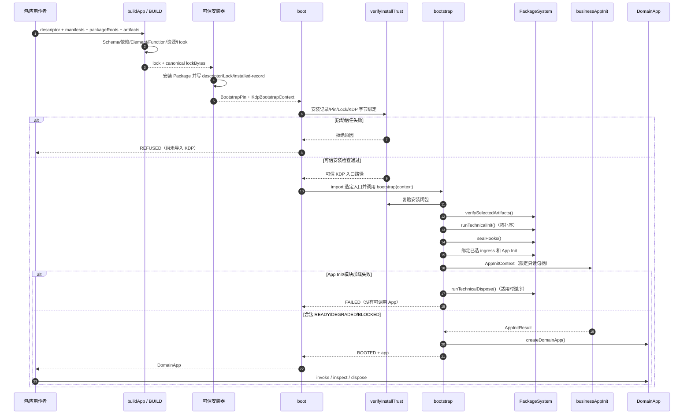

# DomainHarness 0.11.0 源码逻辑与调用流程（维护者指南）

> **适用范围**：仅说明 `version/v0.11.x` 中 0.11.0 Foundation/Stage-0 的实际实现。本文依据公开包根导出与源码调用顺序整理，并非未来 Agent/Workflow/LLM 的设计承诺。新增代码注释只解释不变量，不改变程序行为。
>
> **阅读建议**：先阅读 ``4. 整体时序``，再按 ``5–9`` 逐层跳转源码；如果遇到失败，直接查 ``10. 错误与排障``。

## 1. 代码结构、唯一职责和入口

| Workspace | 包及源码入口 | 当前职责 | 不承担的职责 |
|---|---|---|---|
| Contracts | [`packages/contracts/src/index.ts`](../../packages/contracts/src/index.ts)；`@kaicreator/domain-harness-contracts` | Descriptor、Element、Manifest、Lock、Pin、App、Outcome 类型和 JSON Schema、摘要/错误码 | 不选实现、不导入业务模块 |
| BUILD | [`tooling/build/src/index.ts`](../../tooling/build/src/index.ts)；`@kaicreator/domain-harness-build` | `buildApp` 解析选定闭包、校验合同/资源、封存确定性 Lock | 不安装、启动或执行 Domain App |
| Microkernel | [`packages/microkernel/src/index.ts`](../../packages/microkernel/src/index.ts)；`@kaicreator/domain-harness-microkernel` | `boot`、`bootstrap`，可信安装校验、已选 Package 生命周期、App Init、只读资源与 Function 调用 | 不重跑 BUILD、不创建第二个 Kernel、不给未声明 Effect 授权 |
| SDK | [`packages/domain-harness/src/index.ts`](../../packages/domain-harness/src/index.ts)；`@kaicreator/domain-harness` | 公共消费者唯一包根，重导出 Contracts/BUILD/Microkernel | 不复制第二套 Runtime 或 Compiler |

公共消费者的**实际导入**为：

```js
import { buildApp, boot, canonicalJson, contentDigestOf } from '@kaicreator/domain-harness';
```

完整演示在 [`examples/basic-domain-app/consumer.mjs`](../../examples/basic-domain-app/consumer.mjs)，独立安装驱动在 [`verify-clean-install.mjs`](../../examples/basic-domain-app/verify-clean-install.mjs)。不要从旧版子路径、测试夹具或内部 `src` 文件直接导入正式 API。

## 2. 五种关键数据及所有权

| 数据 | 生产者、阶段 | 核心字段 | 消费者与约束 |
|---|---|---|---|
| `DomainAppDescriptor` | 应用作者，BUILD 输入 | `roots`、`extensions`、`target`、`businessAppInit`、`ingress`、`config` | BUILD 解析；KDP 只读取已固定的 descriptor 文件及其 config |
| `DomainPackageManifest` / `ElementDefinition` | 包/领域作者，BUILD 输入 | 包层次/角色、`dependsOn`、`exports` / `imports`、目标实现、Hook、Element/Function、Schema/资源引用 | BUILD 校验所有权、导出可见性、目标匹配和资源字节 |
| `DomainAppLock` | `buildApp` | 选定 Package/Element/Function、Hook、`resourceDigests`、`technicalInitOrder` / `technicalDisposeOrder`、`bootstrapKdpPin`、`closureDigest` | 安装器写入 `lockBytes`；KDP 只能执行已选结果，**不是运行期依赖解算器** |
| `InstalledRecord` | **受信安装器**，不是 BUILD 自动创建 | App/Target、Lock 路径和摘要、KDP 包和入口摘要、`recordDigest` | Boot 信任锚，位于 `dh-install/installed-record.json` |
| `BootstrapPin` + `KdpBootstrapContext` | Host / 启动调用方 | KDP 包 ID、入口、摘要、Lock 摘要与路径；`installRoot` / descriptor/lock 路径 / 环境 | Boot 把 Pin 与安装记录绑定，不接受自主选择另一个 KDP |

`closureDigest` 是去掉其自身的 Lock 规范 JSON 的摘要；`recordDigest` 同理绑定安装记录。**摘要一致性不等于自动完成安装**。BUILD 返回 `lock` 与 `lockBytes`，可信安装器必须负责写出文件、部署选定的 Package、生成与实际字节一致的安装记录和 Pin。

## 3. 关键依赖与能力边界

```text
包作者/领域定义 → DomainAppDescriptor + DomainPackageManifest + ElementDefinition
                  │
                  ▼
           buildApp (BUILD)
                  │ Lock + lockBytes（未运行）
                  ▼
    可信安装器写出 descriptor / Lock / installed-record + Package 文件
                  │ BootstrapPin + KdpBootstrapContext
                  ▼
                boot
                  │ verifyInstallTrust → import 已 Pin 的 KDP
                  ▼
             bootstrap
                  │ PackageSystem → businessAppInit
                  ▼
             DomainApp
                  ├── invoke(ingressId, input)
                  ├── inspect()
                  └── dispose()
```

这里有三条不变量：

1. **构建期决定“执行什么”**：确定选定包、Function 的具体实现、资源与顺序；运行期不得根据语义或环境重新做实现选择。
2. **启动期决定“能否执行”**：先比对可信安装记录、Lock、KDP 字节，然后才触发 ESM 模块求值；没有 Pin 的模块不能凭名字进入执行。
3. **应用期决定“怎样拒绝”**：仅调用 Lock 中公布的 ingress，使用选定 Schema、Outcome 和资源句柄；0.11.0 只支持 `effects: 'none'`，不提供任意 Host Effect 权限。

## 4. 全调用时序（源码可逐步对照）



`BOOTED` 代表 KDP 返回了 App，不等于任何状态都可调用入口：`READY` 可调用；`DEGRADED` 只能禁用提前声明为 optional 的入口；`BLOCKED` 的实例不能调用入口；`App Init=FAILED` 会使 bootstrap 失败而不交付 App。

## 5. BUILD：从声明到确定性 Lock

主入口：[`tooling/build/src/build.ts → buildApp / runBuild`](../../tooling/build/src/build.ts)。

1. `SchemaChecker.validateDocument` 检查 Descriptor、Domain 和包 Manifest 的机器 Schema；目标限定为当前受支持的 Node ESM Profile。所有结构性拒绝统一为 `BuildResult.ok=false` 和错误码/路径。
2. 由三层 `kernelPrimary` / `sdkPrimary` / `businessPrimary` 和显式 `extensions` 开始，沿 `dependsOn` 与接口导出验证构建**已选 Package 闭包**；不从全部候选包中随意选一个。
3. `ResourceScope` 使用资源相对路径和真实文件路径检查（包括符号链接解析），按**原始字节**比对 `ResourceRef.digest`；验证 Element 定义并建立唯一所有权、版本与可见性索引。
4. [`graph.ts → kahnTopologicalOrder`](../../tooling/build/src/graph.ts) 确认 Element 的**构建期静态依赖 DAG**无环；这不是执行 Task Workflow。
5. 为每个公开 `ingress` 精确定位 `ElementRef + FunctionRef`；重复入口 ID 在 BUILD 就拒绝。`businessAppInit` 必须是唯一、已选、归 Business 层并获导出许可的 Function。
6. 对已选 Function 选择**恰好一个**兼容目标实现。检查实现模块的包归属、导出可见性与字节摘要；仅 `effects='none'` 可封存。校验输入/输出 Schema 并保存允许的 Outcome 与声明资源。
7. BUILD 校验 Hook 的 `interfaceSchemaRef`（inline 或已选文件），按 cardinality 与 Provider 排序封存 Hook；校验成对技术生命周期。
8. 计算 `technicalInitOrder` 的稳定拓扑序和 `technicalDisposeOrder` 逆序；未知但可选的 Content 标记到 `excludedUnknownContent`，未知且 required 的 Content 被拒绝。
9. 组装 `DomainAppLock` 与 `resourceDigests`、`bootstrapKdpPin`、`closureDigest`；再次组装并比较规范 JSON，确保同一输入可复现。返回 `{ ok:true, lock, lockBytes }`，不写文件、不启动模块。

### BUILD 关联实现

- [`schema-check.ts`](../../tooling/build/src/schema-check.ts)：Ajv 编译期验证和 Function 可执行 JSON Schema 子集白名单。
- [`resources.ts`](../../tooling/build/src/resources.ts)：包根路径、实际字节读取、摘要与封存资源表。
- [`graph.ts`](../../tooling/build/src/graph.ts)：依赖拓扑排序与简化 SemVer 范围判断。
- [`refusal.ts`](../../tooling/build/src/refusal.ts)：`BuildRefusal` 转成结构化 `BuildResult` 的约定。

## 6. 安装与 Boot：为什么不是“直接 import KDP”

真实示例：[`consumer.mjs → installBuilt / boot`](../../examples/basic-domain-app/consumer.mjs)。示例在外部安装目录建立如下文件（其中业务包由示例作者提供）：

```text
installRoot/
  dh-install/installed-record.json
  dh-lock/app.lock.json
  descriptor/app.json
  node_modules/
    @kaicreator/domain-harness-microkernel/
    ...已选的其它 Package/
```

真实入口 [`boot.ts → boot`](../../packages/microkernel/src/boot.ts)：
1. `normalizeBootstrapContext` 把外部启动上下文规范化；`readTrustedRecord` 读取受信安装记录并验证其自身摘要。
2. `readPin` 将外部 Pin 读取成普通快照，避免 Getter/Proxy 在同次核验内改变数据；`checkPinAgainstRecord` 对照 Target、KDP 包、入口、摘要及 Lock 路径。
3. `verifyContextPaths` 验证传入路径与记录指向的是 installRoot 内同一文件。
4. [`verify.ts → verifyInstallTrust`](../../packages/microkernel/src/verify.ts) 重算 Lock 的 `closureDigest` 并核对安装记录，按安装包的 `exports['.']` / `main` 找到 KDP 入口，验证实际入口字节与 `kdpPrimaryDigest` 一致。
5. **以上全部成功，才使用动态 ESM import** 导入指定入口，检查导出 `bootstrap` 后交由 KDP。任一步失败返回 `BootResult.status='REFUSED'`，而不是尝试降级选择其它 Kernel。

**信任模型边界**：这里假设安装器及其受信 `installed-record` 来源可信；它校验被记录/Pin 的字节一致性，不实现恶意调用者完全控制 installRoot 时的 PKI 或原生代码沙箱。BUILD/KDP 对 Descriptor 摘要采用的 canonical JSON 与原始字节口径差异仍属于 R12 非阻断 P2（RV-9），真实示例写规范字节保持匹配。

## 7. KDP 与 Package：技术初始化到业务开放

[`kdp.ts → bootstrap`](../../packages/microkernel/src/kdp.ts) 进入时**重新调用** `verifyInstallTrust`，随后执行：

1. 检查 Lock 的 Profile 与 Node 22.12+ 的实际运行条件；读取并比对 Descriptor 文件，取得其 `config`。
2. 创建 [`PackageSystem`](../../packages/microkernel/src/package-system.ts)；`verifySelectedArtifacts` 先验证所选 Package 主产物、Function 模块、Hook Provider 的**所有**可执行字节，再允许执行。
3. `runTechnicalInit` 按 Lock 的 `technicalInitOrder` 导入模块并调用 `technicalInit`；初始化失败只逆序回滚已完成项，清理异常不覆盖第一处失败。`runTechnicalDispose` 依 Lock 的逆序继续清理，即使某个 Package 清理失败。
4. `sealHooks` 逐个加载选定 Provider，检查导出为函数并固定 Hook 表；当前只封存，不在此调用 Hook Provider。
5. 按 Lock 建立 `ingressId → selected Function 实现`，定位唯一 `businessAppInit` 实现并调用。
6. `AppInitContext` 携带 `appId`、`activationId`、`lockDigest`、`config`、受控 Function 句柄，以及**仅来自 `initSelected.resources` 的只读资源句柄**。完整 `lock.resourceDigests` 不是给业务 App Init 的资源目录。
7. App Init 过程中 Function 句柄尚未与 DomainApp 绑定，若试图调用返回 `DH_RUNTIME_NOT_READY`。检查 `AppInitResult`：仅允许预声明的可选 ingress 被 `DEGRADED` 压制；`FAILED`、非法状态或异常不得返回可调用实例。
8. 只有通过这些检查后调用 `createDomainApp`，令 Function 句柄指向 App 并返回 `{ status:'BOOTED', app }`。

**故障回滚**：`runTechnicalInit` 自行处理技术初始化中途失败；技术初始化已经整体成功而后续 Hook/App Init 失败时，`bootstrap` 再触发逆序清理。失败状态返回 `FAILED` 和可诊断错误码/原因；不会悄悄重试 App Init。

## 8. DomainApp：invoke / inspect / dispose

入口：[`domain-app.ts → createDomainApp`](../../packages/microkernel/src/domain-app.ts)。

### invoke（已选直达 Function）

```text
app.invoke(ingressId, input)
  → 已 dispose？/ READY 或 DEGRADED？/ ingress 存在且未 suppressed？
  → 选定 Function effects == 'none'？
  → PackageSystem.functionSchemas() 获取已选的 input/output Schema
  → 校验输入（普通 JSON + 支持的 JSON Schema 子集）
  → 已选 ESM Function(input) 执行
  → normalizeOutcome()：SUCCEEDED / UNKNOWN / FAILED
  → SUCCEEDED 的 value 再校验 outputSchemaRef
  → FunctionOutcome
```

Outcome 三态不能混淆：成功值必须是普通 JSON，缺少合法 Schema 返回 `UNKNOWN`；非法输入、模块异常或成功值未通过输出 Schema 返回 `FAILED`。运行期不调用完整 BUILD Ajv 重新选实现。`schema-subset.ts` 的可执行关键字应与 BUILD 的 `SchemaChecker` 保持一致。

### inspect（元数据观察）

返回 App 身份、Target、选定 Package/Element/Function、公开 ingress 与 DEGRADED 时的被压制入口。内部 target、嵌套 Element/Function Ref、Outcome 列表必须复制成独立快照；**不要把 inspect 返回值当内部 Lock 的可写引用**。

### dispose（单次销毁）

首次调用立刻标记不可再调用，按 Lock 的逆序调用技术销毁；并发重复调用共享同一 Promise（single-flight），不重复执行技术 Dispose。销毁后调用 `invoke` 必须失败。

## 9. 状态与失败归属

| 阶段 | 返回/现象 | 典型触发与源码 |
|---|---|---|
| BUILD | `BuildResult {ok:false, code, message, path?}` | 不可解析引用、多个 Primary、依赖环、未知 required Content、Function 目标多选、Hook Schema 非法；`build.ts` |
| Boot（KDP import 前） | `BootResult {status:'REFUSED', code, reason}` | 安装记录丢失/摘要不符、Pin/Lock/KDP 入口不匹配、路径不可信；`boot.ts` / `verify.ts` |
| KDP（装载/初始化后） | `{status:'FAILED', code, reason}` | 已选产物字节不符、无导出、技术初始化/Hook/App Init 失败、目标运行环境不符；`kdp.ts` / `package-system.ts` |
| App | `FunctionOutcome.kind` | 未知 ingress/非法输入/输出、结果 UNKNOWN、已 dispose、受限 Effect；`domain-app.ts` |
| 成功启动 | `{status:'BOOTED', app}` | App status 仍可能为 READY、DEGRADED 或 BLOCKED；不可把 BOOTED 解释成每个 ingress 都可调用 |

### 精简排障顺序

1. **BUILD 失败**：从 `BuildResult.code/path` 定位 Descriptor/Manifest/Element/资源；先检查所有权、精确版本及 digest，而不是换 Runtime。
2. **Boot REFUSED**：查 `dh-install/installed-record.json`、`dh-lock/app.lock.json`、Pin、`package.json` 导出与 KDP 字节；核对字段和真实 SHA256，不改测试让篡改通过。
3. **KDP FAILED**：查 `verifySelectedArtifacts`、`technicalInitOrder`、Hook/Init 是否对应唯一已选导出，以及是否完成逆序回滚。
4. **invoke FAILED / UNKNOWN**：查 ingress、App.status、所选 Function Schema、Outcome 声明和业务代码返回值；不得把 UNKNOWN 兜底成 SUCCEEDED。
5. **首次看测试**：`npm ci && npm run verify`，其脚本依次执行 4 包构建、生产 Typecheck、源码检查/ESLint、四包测试 Typecheck + runtime tests、真实四 tarball Demo。外部验收驱动不发布 npm 包。

## 10. 核心文件快速阅读索引

| 阅读目标 | 代码文件 / 函数 |
|---|---|
| 结构化契约、用户出口 | [`contracts/src/index.ts`](../../packages/contracts/src/index.ts)、[`domain-harness/src/index.ts`](../../packages/domain-harness/src/index.ts) |
| BUILD 主调用链 | [`build.ts`](../../tooling/build/src/build.ts)：`buildApp` → `runBuild` |
| 资源封存与路径校验 | [`resources.ts`](../../tooling/build/src/resources.ts)：`ResourceScope.read/verify` |
| 图排序与环检测 | [`graph.ts`](../../tooling/build/src/graph.ts)：`kahnTopologicalOrder` |
| 编译期 Function Schema | [`schema-check.ts`](../../tooling/build/src/schema-check.ts)：`compileFunctionSchema` |
| 信任安装/入口字节 | [`verify.ts`](../../packages/microkernel/src/verify.ts)：`readTrustedRecord` → `verifyLockAgainstRecord` → `verifyKdpEntryBytes` |
| Boot 与 KDP 交接 | [`boot.ts`](../../packages/microkernel/src/boot.ts)：`boot` → KDP ESM `bootstrap` |
| KDP 应用启动 | [`kdp.ts`](../../packages/microkernel/src/kdp.ts)：`bootstrap` / `validateInitResult` |
| Package 运行与资源句柄 | [`package-system.ts`](../../packages/microkernel/src/package-system.ts)：`verifySelectedArtifacts` / `runTechnicalInit` / `sealHooks` / `runTechnicalDispose` |
| 业务调用、检查、释放 | [`domain-app.ts`](../../packages/microkernel/src/domain-app.ts)：`invoke` / `inspect` / `dispose` |
| 运行期 Schema 子集 | [`schema-subset.ts`](../../packages/microkernel/src/schema-subset.ts)：`validateJsonSubset` |
| 真实独立消费者 | [`consumer.mjs`](../../examples/basic-domain-app/consumer.mjs)、[`verify-clean-install.mjs`](../../examples/basic-domain-app/verify-clean-install.mjs) |

## 11. 已知限定与后续修改指南

本指南记录 **R15 独立 ACCEPT_SCOPED** 时的代码边界，不能把已知非阻断问题说成解决：

- **RV-5**：Domain semantic relation 与已选 Element 闭包并非全部交叉验证。
- **RV-6**：组合 exports 中带 Element/Function 的情况，Function 存在性验证尚有边界。
- **RV-7**：非 JSON document 的 inline/ref 语义摘要不完全等价。
- **RV-8**：BUILD 的部分非规范 JSON 摘要异常可能不转换为统一 BuildResult。
- **RV-9**：BUILD canonical descriptor 摘要与 KDP 原始 descriptor 字节摘要口径不完全一致。

修改编译期 JSON Schema 允许集或运行期 `validateJsonSubset` 时，必须同时核对另一侧；修改 `Lock`/`Pin` 字段时同步检查受信安装记录和唯一 Demo；修改 Package 生命周期时必须维护预检、回滚和单次 Dispose 的负例。**这仍不是 Agent Loop、持久化 Task、LLM fallback、正式 Host Effect 或 Full Conformance 实现。**

相关记录：[0.11.0 L2](DomainHarness_v0.11.0_L2_ARCHITECTURE_CANDIDATE.md) · [重构与审核经验](../engineering/DOMAIN_HARNESS_V0110_REFACTOR_LESSONS.md) · [单 Demo 中文说明](../../examples/basic-domain-app/README.zh-CN.md)。
