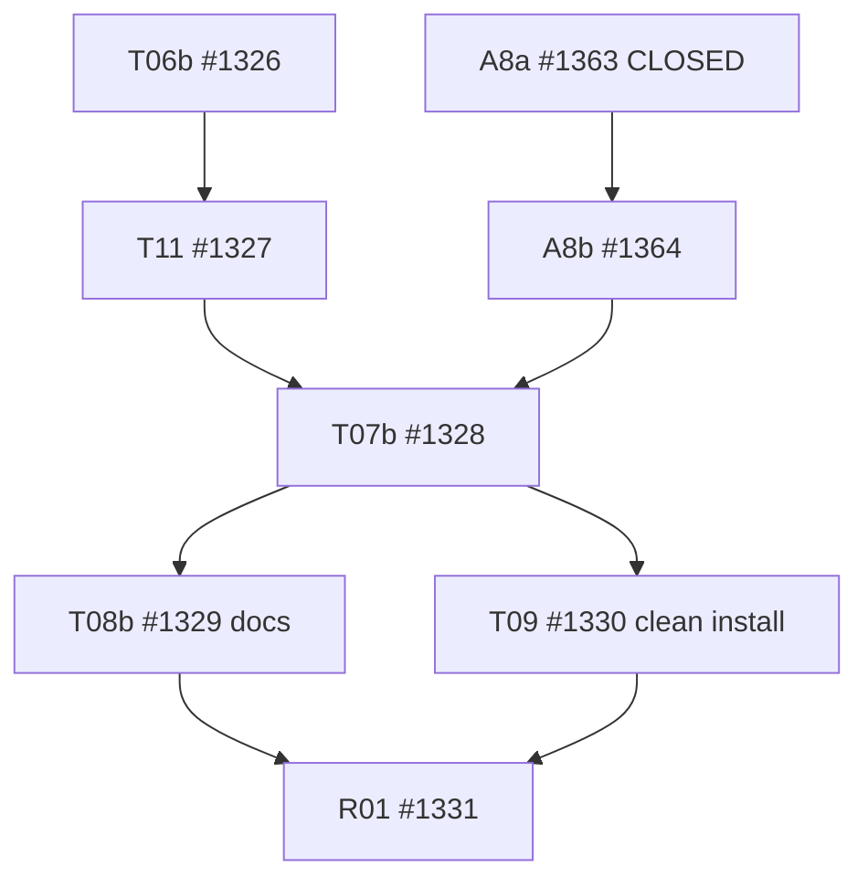

# DomainHarness v0.10.2 — A9 prospective Task DAG critical-path parallelization

Status: **PROPOSED — INDEPENDENT L2/DAG REVIEW REQUIRED; NO TASK GATE CHANGED HERE.**
Version-only candidate; main remains HOLD. Controller: #1300. Baseline: `v0.10.2@247524b64732ecaafe3091d90025a66a52e8f754`. Sources: immutable frozen L2 §12 and §8, adopted A8 R2 8-file BUILD-only writer, A6 docs-draft concession, issues #1326/#1327/#1364/#1328/#1329/#1330/#1331. Do not rewrite the immutable frozen L2 or retroactively reclassify earlier work.

## Problem and dependency types

The adopted A8 overlay placed `T06b → T11 → A8b → T07b → T08b → T09 → R01` along its critical path. **Two edges enforce sequencing without a source/behavioral dependency:**

1. `T11 → A8b`: A8b is narrowed in the independent A8 R2 to **exact eight** `tooling/build/**` files only, with a strict additive BUILD Component projection of previously selected modules. T11 modifies legacy Compiler `C/v10*`, 46 existing root tests/examples and fragment/codmod catalog paths, and does **not** own any of A8b's eight files. A8a #1363 and T05 #1323 are already CLOSED. The extra T11 gate was inherited from an earlier broad A8b design that included S/B/C/Host/Contracts, all explicitly prohibited by A8 R2. A8b needs A8a, frozen A8 R2 and existing T05 ABI, not the T11 codemod. Keep `A8b → T07b` as an actual published BUILD packaging gate.
2. `T08b → T09`: T08b writes documents, manuals, README and migration instructions only. T09 writes clean install/conformance fixtures and examples, whose **final installed validation** depends on T07b manifests/packlist, not on document publication. Both can be reviewed and merged after T07b, provided their overlapping `examples/**` wildcards are resolved by exact file ownership (below). R01—not T09—must await both final docs and integration.

This prospective change additionally reassigns the frozen T08b docs-command acceptance receipt to R01 (see R2 execution-owner contract below); the final review must not accept mere documentation inspection.

Do not remove **genuine** `T06b → T11` (subscription API for cutover), `T11 → T07b` (legacy exports and committed dist cleanup), `A8b → T07b` (BUILD publish), `T07b → T09` (actual clean install), or `T09 → R01` (physical release evidence).

## Proposed exact DAG delta

| Current edge | Prospective action | Evidence/justification |
| --- | --- | --- |
| T11 #1327 → A8b #1364 | **REMOVE** | Exact A8b BUILD-only write set is disjoint from T11 and mapping uses already frozen ABI |
| T08b #1329 → T09 #1330 | **REMOVE** | Docs cannot authorize clean-install runtime; no test or publication dependence |
| T08b #1329 → R01 #1331 | **ADD** | R01 must **execute** final documented quickstart, install and example commands once after both completed lanes, record actual Node24 exit codes and installation SHA/provenance; doc text inspection alone is insufficient |
| A8a #1363 → A8b #1364 | KEEP | A8a is CLOSED |
| T06b #1326 → T11 #1327 | KEEP | Actual subscribe code/selected import consumers |
| T11 #1327 → T07b #1328 | KEEP | Legacy cutover precedes final manifest/CI pruning |
| A8b #1364 → T07b #1328 | KEEP | Component BUILD export included in final tarball |
| T07b #1328 → T08b #1329 | KEEP | Final names/public docs against installed export set |
| T07b #1328 → T09 #1330 | KEEP | Only actual final Node24 clean pack/install proves conformance |
| T09 #1330 → R01 #1331 | KEEP | Final Tiny/Rich installed results before release decision |

**R2 corrected accounting:** the A8 overlay described **20 nodes / 24 edges** as a *reduced summary* and did not enumerate frozen Issue #1330's additional direct predecessor `T07b → T09`. The complete live Issue-native adopted graph before A9 has **20 nodes / 25 distinct direct edges**. Applying REMOVE `T11→A8b`, REMOVE `T08b→T09`, ADD `T08b→R01` yields **20 nodes / 24 direct edges**, not 23. Both `T07b→T09` and `T07b→T08b` remain explicit. The complete enumerated before/after edge roster and deterministic proof appear below, not an inferred subtraction from the reduced summary.

**Parallel lanes after approval:**
- NOW: **A8b BUILD-only implementation || T06b governed subscription implementation**. T11 may create A6 candidate codemod previews, never publish/merge before T06b.
- After T06b: T11 can implement/merge while A8b independently implements/merges. Whichever finishes second unlocks T07b.
- While awaiting T11/A8b: T07b may prepare source-only export/CI/packlist analysis in a draft branch with **no premature merge**, and T08b PR #1349 may refine draft docs. Neither can claim release-qualified exports.
- After T07b: **T08b FINAL docs || T09 final Tiny/Rich integration**, in two nonoverlapping PRs.
- After T08b and T09 independently merge: R01 executes **the final documentation command set once**, plus one Full/Hidden/Critical/Packaging release qualification on the joined exact version SHA; does not repeat earlier green T09 clean-consumer install runs when their blobs and clean pack evidence are unchanged.

## Exact file ownership / possible overlap proof

| Task | Physical writer | Concurrent disjointness / guard |
| --- | --- | --- |
| A8b #1364 | **Only** `tooling/build/src/component-view.ts`, `tooling/build/dist/component-view.{js,d.ts}`, `tooling/build/src/index.ts`, `tooling/build/dist/index.{js,d.ts}`, `tooling/build/tests/component-view.test.ts`, `tooling/build/README.md` | T11 has no `tooling/build/**` writer; it owns legacy C/tests/examples, fragment, catalog. T07b cannot modify BUILD-owned files and remains after both |
| T06b #1326 | Microkernel subscribe observer/runtime and Host governed subscribe/stop, approved assembly/Host tests | Does not change the eight BUILD-owned A8b files. Read-only T06a projection stays frozen |
| T11 #1327 | Actual 46 root tests/examples, legacy compiler C paths, fragment, catalog | Serial after T06b; never modifies A8b source/export files; read A8b public signature only |
| T07b #1328 | Package/root manifests, locks, Node24 CI, legacy dist and packlist test | MUST await T11 + A8b; physical final packaging gate |
| T08b #1329 | `README.md`, `docs/sdk|guides|migration/**`, **`examples/**/README.md`**, legacy package READMEs | Own **ALL** existing/new example README destinations while T08b and T09 concurrent |
| T09 #1330 | `tests/integration/v010-clean-consumers/**`, `examples/v010-clean-consumer/**`, `examples/v0102-external-producer/**` **EXCEPT `**/README.md` files** | Explicit proposed write-set SUBTRACTION: no README writes, no doc-only files. New external-producer README, if needed, is created/updated only by T08b once the example's installed API is known. Confirm GitHub file list by exact path, not wildcard alone |
| R01 #1331 | Evidence only | No source edits; waits BOTH T08b and T09; actually executes final approved README/docs commands against the exact installed Node24 candidate once |

**Write-set stop rule:** if a T09 physical fix actually requires any example README path or a T11-owned file while those tasks are running, stop and assign a single writer in a prospective reviewed exception. No common-path writes merely because both tasks share a coarse `examples/**` prefix. T07b's manifest edits remain single-owner. This amendment changes only dependencies/ownership, never payload or public ABI.

## Evidence and acceptance unchanged

- No new Task count (20 unchanged); **implementation scope unchanged**. Do not introduce an extra full test suite or new runtime.
- Independent reviewer checks original frozen L2 exact blobs, A8 R2 eight-file bounds, T11 46 root test footprint, T08b/T09 exact README overlap, full DAG acyclic/reachability, and whether any A8b import depends on an import removed by T11.
- T06b Node24 targeted tests and N1–N7 still required; A8b Node24 build + targeted component tests and generated dist parity still required; T11 root/codemod witnesses and T07b Node24 packlist/CI still required; T09 clean-install conformance still required; R01 executes exact final README/docs commands **once** plus Full/Hidden/Critical once. A document-review PR or T09 run before the docs existed is never a docs-command PASS.
- **Approval gate:** independent exact-HEAD review P0/P1/P2, `A9_PARALLEL_DAG_READY=YES`, `WRITESET_DISJOINT=YES`; only then version-merge this docs-only amendment and prospectively update Issues #1364, #1328, #1329, #1330, #1331; A8b may begin its BUILD-only implementation without T11 after that adoption. Draft work before adoption is possible only if no conflict and no merge.
- Do not use A9 to reopen completed T03b or A8a. No main merge or Release PASS on this amendment.

## A9 R2 — exact native DAG, acceptance-owner correction (supersedes R1 P1-01/P1-02)

Independent R1 at PR #1370 exact `5bae6db5f48a72bc246271829ad07f27e5061d96` correctly reported `BLOCK P0=0/P1=2/P2=0`. This R2 repairs **only this candidate document**; no frozen L2 bytes or Task code altered.

### P1-01: documents command execution changes owner, not acceptance

Frozen L2 §12 T08b says “none (docs); commands executed once at T09.” The former `T08b→T09` edge guaranteed command texts existed. Removing that edge requires one explicit prospective reassignment:

- **T09 #1330 (after T07b):** owns the Node24 `Tiny/Rich` clean `npm pack/install`, closure allowlist and external producer journey source/tests, verifying **behavior** regardless of draft-final docs timing. It **does not** certify not-yet-published doc/README commands. Keep its original executable conformance criteria and actual process exits.
- **T08b #1329 (after T07b):** owns final READMEs, SDK/migration/guides, actual complete documented command inventory and expected installed package refs, plus all `examples/**/README.md` (including new producer READMEs). Its PR proves documentation/source content, **not** actual command execution. Annotate `DOC_COMMANDS_EXECUTION=DEFERRED_TO_R01`.
- **R01 #1331 (after BOTH T08b and T09):** becomes the **sole actual documentation-command execution owner**. On final version-branch exact SHA, collect all executable commands from root README, SDK quickstart, migration examples and Tiny/Rich/external-producer example READMEs; execute the documented install, import, build and example commands in one verified Node24 clean-installed candidate, record per-command path, shell command, exit code, output/candidate pack digests, and precise NOT_RUN/waiver if applicable. Failure or NOT_RUN in mandatory commands is **R01 BLOCK**. Reuse T09's physically green pack/install receipts for unchanged package bytes instead of repacking or re-running whole suites. This execution must happen **after final T08b merge** and is separate from one full/hidden/critical release qualification on the same exact release candidate; no per-task full regression.
- **Prospective Issue addenda** must explicitly supersede only this single L2 §12 verification-owner row and its predecessor edges for #1329/#1330/#1331. Original frozen L2 blob remains immutable; do not claim the earlier T09 run proved final docs.
- **Negative:** a successful docs-only CI, a T09 source-only PR, or final R01 reading README text without executing commands **never** equals docs-command PASS.

### P1-02: 20 nodes, 25 original direct edges, 24 proposed direct edges

The originally accepted A8 overlay counted 24 edges as a **transitively reduced view**. The actual T09 Issue #1330 states direct dependencies on **both T07b and T08b**. Reviewer independently located the `T07b→T09` native edge. The full issue-native roster, including A1/A2/A3/A8 adoption and all twenty known Task IDs:

01. `T07a → T07a2`
02. `T01 → T07a2`
03. `T07a2 → T07a3`
04. `T01k → T07a3`
05. `T07a3 → T00`
06. `T01 → T01k`
07. `T00 → T05`
08. `T00 → T03a`
09. `T05 → T04`
10. `T01k → T04`
11. `T04 → T03b`
12. `T03a → T03b`
13. `T04 → T06a`
14. `T03b → T06b`
15. `T06a → T06b`
16. `T08a → T11`
17. `T06b → T11`
18. `A8a → A8b`
19. `T11 → A8b` **REMOVE under A9**
20. `T11 → T07b`
21. `A8b → T07b`
22. `T07b → T08b`
23. `T07b → T09`
24. `T08b → T09` **REMOVE under A9**
25. `T09 → R01`

Add one prospective edge: `T08b → R01`. Exactly `25 − 2 + 1 = 24` direct issue-native edges:

01. `T07a → T07a2`
02. `T01 → T07a2`
03. `T07a2 → T07a3`
04. `T01k → T07a3`
05. `T07a3 → T00`
06. `T01 → T01k`
07. `T00 → T05`
08. `T00 → T03a`
09. `T05 → T04`
10. `T01k → T04`
11. `T04 → T03b`
12. `T03a → T03b`
13. `T04 → T06a`
14. `T03b → T06b`
15. `T06a → T06b`
16. `T08a → T11`
17. `T06b → T11`
18. `A8a → A8b`
19. `T11 → T07b`
20. `A8b → T07b`
21. `T07b → T08b`
22. `T07b → T09`
23. `T09 → R01`
24. `T08b → R01`

Topological verification (explicit Kahn traversal over the **twenty** node IDs and above exact edges):
- Baseline: `NODE_COUNT=20; DIRECT_EDGE_COUNT=25; VISITED=20; CYCLE=NO`.
- A9 prospective: `NODE_COUNT=20; DIRECT_EDGE_COUNT=24; VISITED=20; CYCLE=NO`.
- One valid prospective ordering: `T07a → T01 → T08a → A8a → T07a2 → T01k → A8b → T07a3 → T00 → T05 → T03a → T04 → T03b → T06a → T06b → T11 → T07b → T08b → T09 → R01`.
- **Unordered/concurrent**: T06b vs A8b; T11 vs A8b; T08b vs T09. The A8b eight BUILD-only files and T11 exact Compiler/tests/files are disjoint; T08b owns every example README and T09 excludes them; no concurrent code writer changes an A8b source path or any T07b manifest. Frozen T06b→T11 and joint T11+A8b→T07b unchanged.
- Exact total progress at this amendment preparation: `13 CLOSED / 20` (unaffected by a docs-only DAG candidate). Current `v0.10.2` baseline recorded above.

**R2 independent reviewer acceptance:** verify all 25 original direct edges against current GitHub Issue addenda, all 24 proposed edges against proposed updates, Kahn visited 20, source/write sets and README subtraction, doc-command execution owner/R01 gate, and zero altered frozen blobs. Return `P0/P1/P2`, `A9_PARALLEL_DAG_READY`, `WRITESET_DISJOINT`, `DOC_COMMAND_EXECUTION_OWNER=R01`, `MERGE_ELIGIBLE_DOC_VERSION_ONLY`; no source code merge or main integration before independent PASS.
