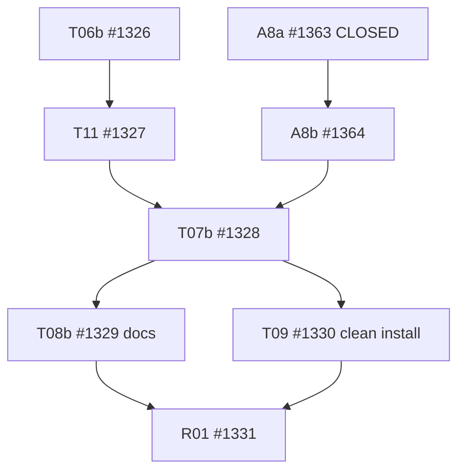

# DomainHarness v0.10.2 — A9 prospective Task DAG critical-path parallelization

Status: **PROPOSED — INDEPENDENT L2/DAG REVIEW REQUIRED; NO TASK GATE CHANGED HERE.**
Version-only candidate; main remains HOLD. Controller: #1300. Baseline: `v0.10.2@247524b64732ecaafe3091d90025a66a52e8f754`. Sources: immutable frozen L2 §12 and §8, adopted A8 R2 8-file BUILD-only writer, A6 docs-draft concession, issues #1326/#1327/#1364/#1328/#1329/#1330/#1331. Do not rewrite the immutable frozen L2 or retroactively reclassify earlier work.

## Problem and dependency types

The adopted A8 overlay placed `T06b → T11 → A8b → T07b → T08b → T09 → R01` along its critical path. **Two edges enforce sequencing without a source/behavioral dependency:**

1. `T11 → A8b`: A8b is narrowed in the independent A8 R2 to **exact eight** `tooling/build/**` files only, with a strict additive BUILD Component projection of previously selected modules. T11 modifies legacy Compiler `C/v10*`, 46 existing root tests/examples and fragment/codmod catalog paths, and does **not** own any of A8b's eight files. A8a #1363 and T05 #1323 are already CLOSED. The extra T11 gate was inherited from an earlier broad A8b design that included S/B/C/Host/Contracts, all explicitly prohibited by A8 R2. A8b needs A8a, frozen A8 R2 and existing T05 ABI, not the T11 codemod. Keep `A8b → T07b` as an actual published BUILD packaging gate.
2. `T08b → T09`: T08b writes documents, manuals, README and migration instructions only. T09 writes clean install/conformance fixtures and examples, whose **final installed validation** depends on T07b manifests/packlist, not on document publication. Both can be reviewed and merged after T07b, provided their overlapping `examples/**` wildcards are resolved by exact file ownership (below). R01—not T09—must await both final docs and integration.

Do not remove **genuine** `T06b → T11` (subscription API for cutover), `T11 → T07b` (legacy exports and committed dist cleanup), `A8b → T07b` (BUILD publish), `T07b → T09` (actual clean install), or `T09 → R01` (physical release evidence).

## Proposed exact DAG delta

| Current edge | Prospective action | Evidence/justification |
| --- | --- | --- |
| T11 #1327 → A8b #1364 | **REMOVE** | Exact A8b BUILD-only write set is disjoint from T11 and mapping uses already frozen ABI |
| T08b #1329 → T09 #1330 | **REMOVE** | Docs cannot authorize clean-install runtime; no test or publication dependence |
| T08b #1329 → R01 #1331 | **ADD** | R01 must check final independently reviewed docs and migration references |
| A8a #1363 → A8b #1364 | KEEP | A8a is CLOSED |
| T06b #1326 → T11 #1327 | KEEP | Actual subscribe code/selected import consumers |
| T11 #1327 → T07b #1328 | KEEP | Legacy cutover precedes final manifest/CI pruning |
| A8b #1364 → T07b #1328 | KEEP | Component BUILD export included in final tarball |
| T07b #1328 → T08b #1329 | KEEP | Final names/public docs against installed export set |
| T07b #1328 → T09 #1330 | KEEP | Only actual final Node24 clean pack/install proves conformance |
| T09 #1330 → R01 #1331 | KEEP | Final Tiny/Rich installed results before release decision |

The currently adopted DAG reports 20 tasks / 24 edges. If the two removed and one added edge correspond to that exact source edge set, new count is **20 tasks / 23 edges**. Independent reviewer must rederive the *full* native edge roster, confirm no hidden transitive constraints or cycles, and verify reachability before claiming this count.

**Parallel lanes after approval:**
- NOW: **A8b BUILD-only implementation || T06b governed subscription implementation**. T11 may create A6 candidate codemod previews, never publish/merge before T06b.
- After T06b: T11 can implement/merge while A8b independently implements/merges. Whichever finishes second unlocks T07b.
- While awaiting T11/A8b: T07b may prepare source-only export/CI/packlist analysis in a draft branch with **no premature merge**, and T08b PR #1349 may refine draft docs. Neither can claim release-qualified exports.
- After T07b: **T08b FINAL docs || T09 final Tiny/Rich integration**, in two nonoverlapping PRs.
- After T08b and T09 independently merge: R01 one full/hidden/critical/packaging release qualification on final exact version SHA.

## Exact file ownership / possible overlap proof

| Task | Physical writer | Concurrent disjointness / guard |
| --- | --- | --- |
| A8b #1364 | **Only** `tooling/build/src/component-view.ts`, `tooling/build/dist/component-view.{js,d.ts}`, `tooling/build/src/index.ts`, `tooling/build/dist/index.{js,d.ts}`, `tooling/build/tests/component-view.test.ts`, `tooling/build/README.md` | T11 has no `tooling/build/**` writer; it owns legacy C/tests/examples, fragment, catalog. T07b cannot modify BUILD-owned files and remains after both |
| T06b #1326 | Microkernel subscribe observer/runtime and Host governed subscribe/stop, approved assembly/Host tests | Does not change the eight BUILD-owned A8b files. Read-only T06a projection stays frozen |
| T11 #1327 | Actual 46 root tests/examples, legacy compiler C paths, fragment, catalog | Serial after T06b; never modifies A8b source/export files; read A8b public signature only |
| T07b #1328 | Package/root manifests, locks, Node24 CI, legacy dist and packlist test | MUST await T11 + A8b; physical final packaging gate |
| T08b #1329 | `README.md`, `docs/sdk|guides|migration/**`, **`examples/**/README.md`**, legacy package READMEs | Own **ALL** existing/new example README destinations while T08b and T09 concurrent |
| T09 #1330 | `tests/integration/v010-clean-consumers/**`, `examples/v010-clean-consumer/**`, `examples/v0102-external-producer/**` **EXCEPT `**/README.md` files** | Explicit proposed write-set SUBTRACTION: no README writes, no doc-only files. New external-producer README, if needed, is created/updated only by T08b once the example's installed API is known. Confirm GitHub file list by exact path, not wildcard alone |
| R01 #1331 | Evidence only | No source edits; waits BOTH T08b and T09 |

**Write-set stop rule:** if a T09 physical fix actually requires any example README path or a T11-owned file while those tasks are running, stop and assign a single writer in a prospective reviewed exception. No common-path writes merely because both tasks share a coarse `examples/**` prefix. T07b's manifest edits remain single-owner. This amendment changes only dependencies/ownership, never payload or public ABI.

## Evidence and acceptance unchanged

- No new Task count (20 unchanged); **implementation scope unchanged**. Do not introduce an extra full test suite or new runtime.
- Independent reviewer checks original frozen L2 exact blobs, A8 R2 eight-file bounds, T11 46 root test footprint, T08b/T09 exact README overlap, full DAG acyclic/reachability, and whether any A8b import depends on an import removed by T11.
- T06b Node24 targeted tests and N1–N7 still required; A8b Node24 build + targeted component tests and generated dist parity still required; T11 root/codemod witnesses and T07b Node24 packlist/CI still required; T09 clean-install conformance still required; R01 Full/Hidden/Critical once still required.
- **Approval gate:** independent exact-HEAD review P0/P1/P2, `A9_PARALLEL_DAG_READY=YES`, `WRITESET_DISJOINT=YES`; only then version-merge this docs-only amendment and prospectively update Issues #1364, #1328, #1329, #1330, #1331; A8b may begin its BUILD-only implementation without T11 after that adoption. Draft work before adoption is possible only if no conflict and no merge.
- Do not use A9 to reopen completed T03b or A8a. No main merge or Release PASS on this amendment.
