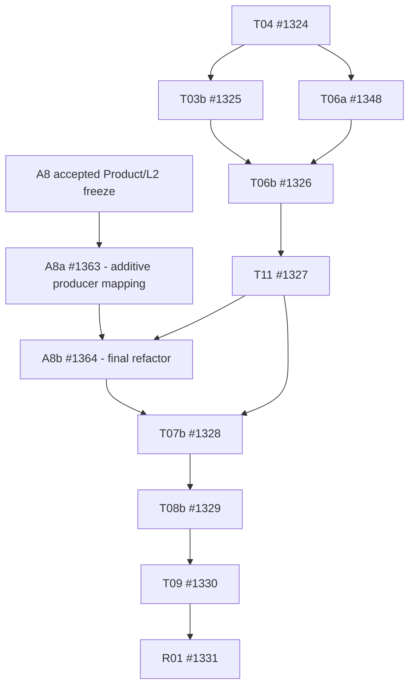

# v0.10.2 A8 — prospective Task DAG overlay

Status: **PENDING_INDEPENDENT_PRODUCT_L2_REVIEW**. Candidate documents and all Task references are **proposed**, not admitted. This file does not modify frozen DAG records. Parent #1361, A8a #1363, A8b #1364, PR #1362.

## Exact topology

- Existing closed 9/18 tasks stay CLOSED. Existing OPEN: T04 #1324, T03b #1325, T06a #1348, T06b #1326, T11 #1327, T07b #1328, T08b #1329, T09 #1330, R01 #1331.
- Add `A8a #1363` with dependency on **A8 Product/L2 accepted prospective freeze only**, no predecessor T04/T03b/T06a: source/test write set is entirely new, so it can run now in parallel once admitted.
- Add `A8b #1364` with dependencies `A8a #1363` AND `T11 #1327`; T11 itself follows T06b. A8b's existing-file write set must be explicitly L2 assigned for a **single serialized late refactor**.
- Add the one new downstream edge `A8b #1364 -> T07b #1328`, retaining existing `T11 #1327 -> T07b #1328`, then `T07b #1328 -> T08b #1329 -> T09 #1330 -> R01 #1331`. Never push A8b **after** T07b/T09 or defer its tests to after R01.
- T03b and T06a remain parallel draft/integration work after T04 only; A8a never edits their source paths.
- A8b must be independently reviewed/merged into **v0.10.2 version branch** before T07b accepts any final manifests/tarballs.

All edges point forward; no circular waits with the A8a disjoint owner. On formal admission only: old 18 + A8a + A8b = **20 tasks**. Until admission report **9/18 = 50%** and A8a/A8b separately as PROPOSED; afterward 9/20 = 45% until first newly merged task is closed.

## Write ownership and next gates

A8a: only new `docs/architecture/v0.10.2/a8/**`, new `tooling/component-bridge/**` source/tests with prospective Product/L2 authorization; no updates to old role/ABI or manifests.

A8b: candidate Contracts/BUILD/selected S/B/C/Host and component producer/test paths — **NO blanket write authorization**. Independent L2 must enumerate exact paths and exclude or serialize conflicts with completed T05 and future T07b package.json/lockfile/dist/CI. For generic Hook or per-handler effect ABI changes that cannot fit bounded tests, expose an explicit typed UNSUPPORTED rather than introducing a new runtime.

Validation: independent A8 Product/L2 SHA review + DAG noncycle/write-set matrix → one scoped Node24 test per concern → Tiny/Rich clean install once at T09 → Full/Hidden/Critical/Package qualification once at R01. Main integration withheld through release gate.

## A8 R2 exact ownership / sequenced reentry
Independent R1 P1-01 is addressed by a **strict BUILD-only late A8b**. A8b exact 8 files (all and only): `tooling/build/src/component-view.ts` (NEW), `tooling/build/dist/component-view.js` (NEW generated), `tooling/build/dist/component-view.d.ts` (NEW generated), `tooling/build/src/index.ts` (T05 owner CLOSED), `tooling/build/dist/index.js` (T05 CLOSED generated), `tooling/build/dist/index.d.ts` (T05 CLOSED generated), `tooling/build/tests/component-view.test.ts` (NEW), `tooling/build/README.md` (T05 CLOSED). Mandatory Node24 tsc emission for generated artifacts. A8b can edit them **only after T11 CLOSED** and independent A8 Product/L2 exact source-review/adoption; T07b then exclusively owns package manifests/CI/lock/legacy dist removal; T09 alone owns clean-consumer fixtures. No A8b `contracts/**`, K/S/B/C payload, `host-node/**`, `package.json`, lock, CI, or T11-selected Compiler/test roots. Explicit writer ordering T05 CLOSED → T11 CLOSED → A8b → T07b → T08b → T09 → R01.

A8a exact new files `tooling/component-bridge/src/component-view.ts` and `tooling/component-bridge/tests/component-view.test.ts`; it is **not an npm workspace** and must contain NO `package.json` or dist/lock/tsconfig files. Its source is a producer-only source map, NOT a published artifact. Explicit Node24 scoped tsx test, no additional engine matrix.

A8b capability support limited to **existing role/ABI** conversion into sealed modules passed to unchanged `buildV10App`; generic Business event hooks, arbitrary remote transport, mixed per-handler effect and independent selection of multiple exports from ONE ESM module remain TYPED UNSUPPORTED. This prevents scope growth during critical path and resolves P1 writer ambiguity. New DAG edges remain A8a + T11 → A8b → T07b (retained T11→T07b), no cycle; final Node24 Tiny/Rich packaging tests remain T09.
