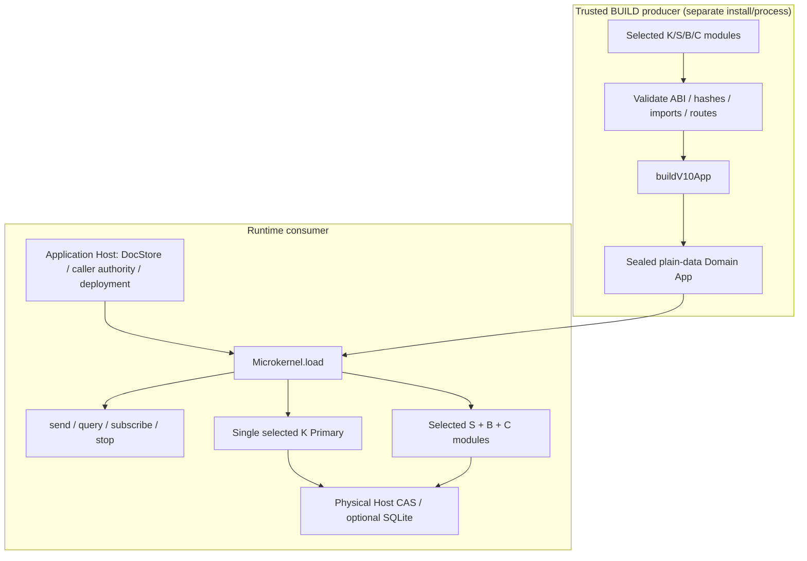
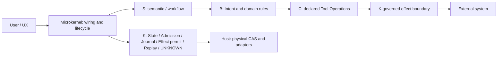
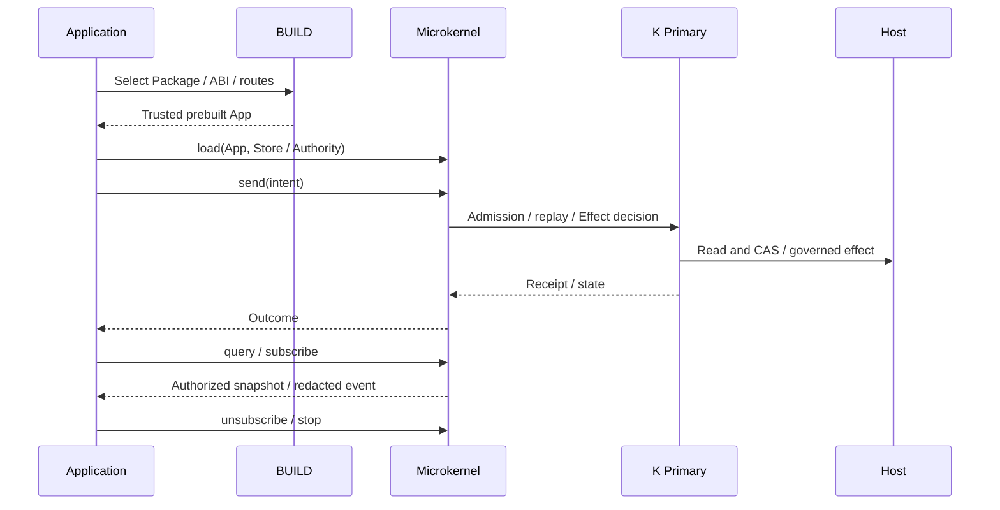

# DomainHarness v0.10.2 — System architecture

[Documentation index](index.md) · [中文版本](../zh-CN/architecture.md)

The system is an **external BUILD producer + Microkernel + selected Domain Packages + optional Host**, not a second state/admission engine inside Microkernel.

## Build/runtime boundary

## Role ownership

## Conceptual journey

**Invariant:** K uniquely owns durable business-state decisions, effect permits and UNKNOWN. Host offers physical operations; `microkernel/host-seam` is API organization, not authorization. A private JS helper is not automatically a Tool. These are conceptual diagrams, not a literal internal call trace. See [frozen L2](../../architecture/DomainHarness_v0.10.2_L2_FREEZE.md).

---

**Version:** immutable tagged runtime `cee14399d9d0af4e20e34b9111861b16a465b690`. RQ **CONDITIONAL** (Full `EXIT1`, root `NOT_RUN` retained). This is post-release explanatory documentation, not a changed ABI.
