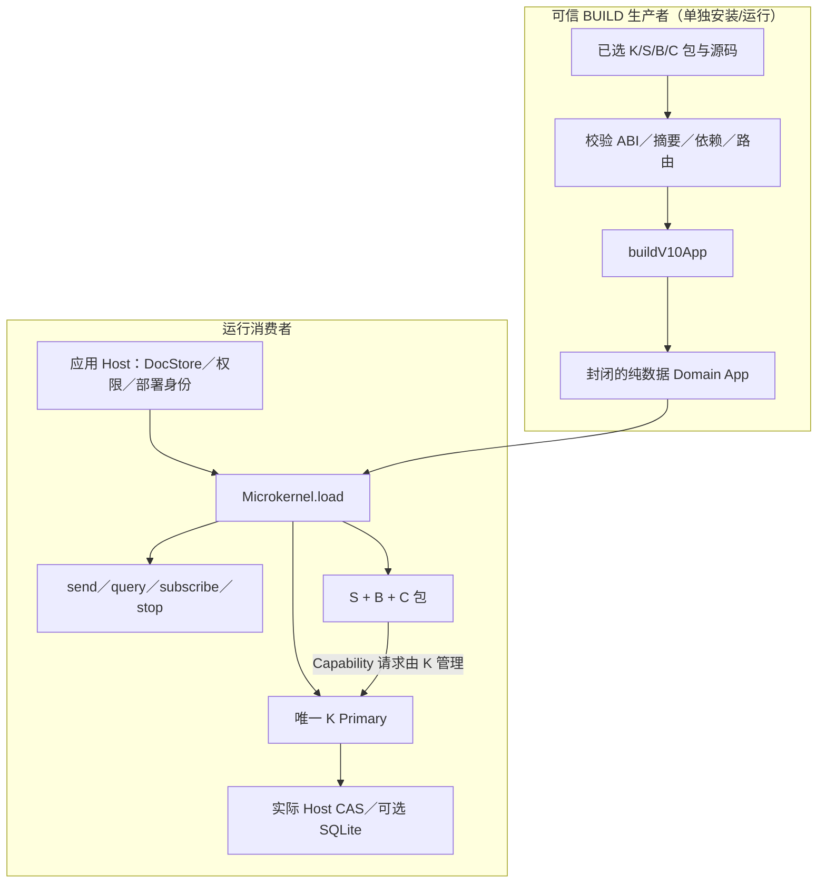
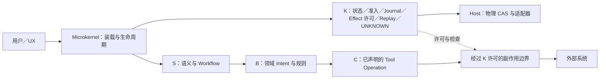
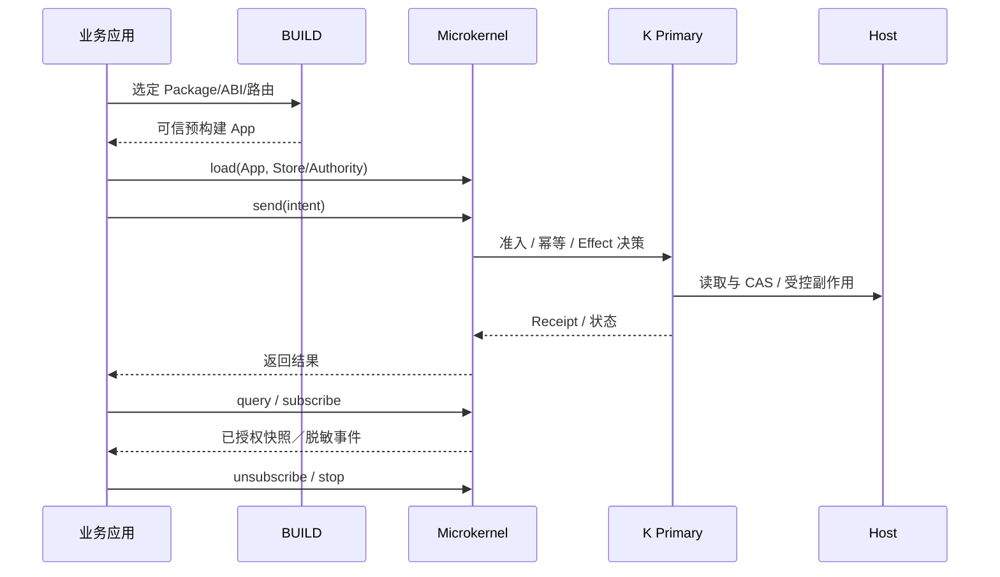

# DomainHarness v0.10.2 · 系统架构

[文档首页](index.md) · [English version](../en/architecture.md)

架构是“**外部 BUILD + Microkernel + 已选 Domain Packages + 可选 Host**”，而不是把 State、Admission 和副作用逻辑重新写进 Microkernel。

## 构建 / 运行边界

## 领域职责

## 调用序列（概念图）

**不可跨越的边界：** K 才能决定持久化业务状态、Effect 许可和 UNKNOWN；Host 只提供物理操作；`microkernel/host-seam` 只是 API 整理，不等于授权；普通 JS helper 不会自动成为 Tool。以上是概念图，不能代替真实运行时调用顺序。详见 [冻结 L2 原文](../../architecture/DomainHarness_v0.10.2_L2_FREEZE.md)。

---

**版本：** 不可变 Tag `cee14399d9d0af4e20e34b9111861b16a465b690`；RQ 为 **CONDITIONAL**，保留 Full `EXIT1` 与 root `NOT_RUN`。本文档仅用于发布后说明，不改变 SDK ABI。
