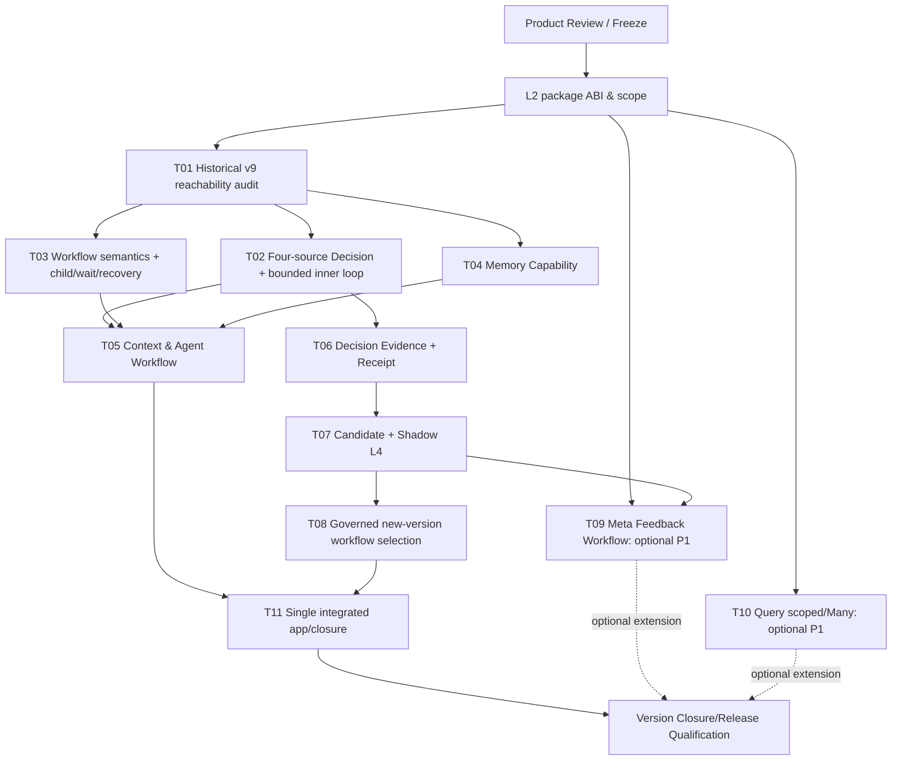

# DomainHarness v0.10 — Proposed Task DAG (NOT ADMITTED)

> **Status:** Product/L1 design seed only; **no formal implementation DAG, Issues or executable task authorizations yet**. Parent [#1139](https://github.com/kaicreator-mm/domain-harness/issues/1139), baseline `main@af069e8319f290093db004a59ad18c572ebc5b26`.
>
> This is not permission to implement before Product/L1 focused review, exact Product Freeze and L2 Architecture Freeze. No old-source, CI or v0.9 evidence is falsely relabeled as v0.10 implementation PASS. One concern per PR; consolidate historical tests rather than create 44 tasks.

## 1. Boundary and sequencing

- **One already qualified K**, one selected S in v0.9 Package ABI, independent B1..Bn and selected Capabilities. Standard **logical components** may co-reside inside one S.
- **L2 first** must check the exact selected K/S API contract for loops, scope binding, currently permitted Operation/Handler class, host read vs mutation and multi-B identity. Broaden K/BUILD only if actual targeted P/N falsification shows a generic missing primitive.
- All code in current public-v9 selected execution path or selected/package-owned implementation; never import `/v3` private runtime state into new runtime facade as a shortcut.

## 2. Candidate DAG table

| Task | Stage | Concern / minimal deliverable | Dependencies | Targeted P/N acceptance |
|---|---|---|---|---|
| **T01** | P0 | **v0.1–v0.6 → v0.9 44-row capability audit** with exact selected public-v9 reachability classifications (R/S/L/O), source/tests and real missing gaps | L2 | One consolidated crosswalk; actual packed-v9 or existing exact witness for every retained row; no 44 separate full suites |
| **T02** | P0 | **Advanced Decision Component**: 4-source resolver + bounded Business Harness/Model↔read-query inner loop, declared semantic decision compiled ABI | T01 | Rule/cache/promoted avoid Model call; LLM optional; maxSteps/timeout; wrong event/capability denied before Effect; one K admission |
| **T03** | P0 | **Generic Workflow extension**: bounded loops/child/WAIT/RESUME/deadline/callback and compiled IR reference reuse | T01 | Child result, suspend/restart, duplicate callback/message, a bounded cycle with exact K state/journal; no new RuntimeV3 |
| **T04** | P0 | **Memory Capability Basic**: scoped put/get/search/delete, CAS revision, TTL and data isolation | T01 | Real selected Host/Storage read-write, cross-B/tenant negative, restart persistence, no Memory Kernel branch |
| **T05** | P0 | **Context Assembly + Agent Workflow** through generic AW and Memory Capability; model optional | T02,T03,T04 | Context source provenance, budget, bounded Agent work, deterministic/no-model mode, no unapproved business mutation |
| **T06** | P0 | **Decision/Evidence Component**: dependency refs, truthful source/model-count, optional DecisionResolutionReceipt and failures | T02 | Origin and `unmeasured` truth, denied/unavailable vs admitted, optional append failure leaves K truth unchanged; forged source rejected |
| **T07** | P0 | **Candidate Validation + Shadow L4** reference as approved Package Components | T06 | Candidate validation, shadow counterexample, 0 production State/Effect writes, exact stable fallback, no floating alias |
| **T08** | P0 | **Governed versioned Pattern/Workflow selection** using existing BUILD/DAC/H approval | T07,T03 | Validated candidate selected only through new sealed approved assembly; revocation/wrong digest/pre-change pin fail-safe; old instance unchanged |
| **T09** | P1 | **Meta Feedback Workflow** over Runtime Evidence → Candidate → Shadow comparison | T07 | Ordinary Business/Meta Workflow, bounded evidence access, no own approval authority; no automatic production activation |
| **T10** | P1 | **Multi-B scoped query / queryMany** | T01 | Duplicate `instanceKey` typed ambiguity, scoped lookup precise, fan-out independent target checks, partial failures recorded, no cross-B transaction claim |
| **T11** | P0 | **One selected external Consumer** 2B + Agent + Shadow + Memory real Node/SQLite | T05,T08 (+T09/T10 if admitted) | Clean packed v9, no deep import; real restart, CAS/UNKNOWN/effect negative, simultaneous two-B, receipt, Shadow 0 effects |
| **R01** | Release | One fixed-SHA full/hidden/CJ/security/packaging + release qualification, tag decision | T11 + admitted P1 | Full source + independent release evidence; `PR_PASS != RELEASE_PASS` |

**No progress percentage should be reported from this candidate DAG as if work had begun.** This is a planning count (11 task seeds + release), not 0/11 GitHub Issues. Once Product/L2 frozen, synthesize **only actual missing** executable Issues and their necessary dependency edges.

## 3. Task-to-historic proof reuse guidance

- **T01** consult [v0.8 frozen 44](./DomainHarness_v0.8_RETAINED_FUNCTION_MANIFEST.json), [R12 successor ledger](../validation/v0.8/tg1006-44-row-successor-outcome-ledger.md), [v0.8 Release qualification](../validation/v0.8/tg1006-release-qualification.md), [v0.9 qualification](../validation/v0.9/n09-release-qualification.md); source presence != current ABI acceptance.
- **T02** re-use v0.3 `harness-machine.ts`, `decision-resolver/resolver.ts`, `semantic-cache/`, v0.6 `runtime/decision-resolver-binding.ts` at historic `7c367188…`; FR07/FR08/FR12/NF05.
- **T03** re-use FR01/HF18/HF32, v0.5 `compiled-workflow-ir-v3.ts`, `compiled-workflow-runtime-v3.ts`, `compiled-workflow-message-effects-v3.ts`; only preserve semantics, not authority.
- **T04/T05** new portable Memory/Context contract; reuse existing K Effect/Journal and selected physical Store, no general Cairn replacement.
- **T06** FR08 SD1/SD2, HF26, NF06 optional receipt history; no mandatory cross-record durability claim.
- **T07/T08** `runtime-evidence/{capture,shadow,fallback}.ts`, `candidate/`, `promoted-artifact/` and `promoted-child/`; migration to v9 sealed ABI.
- **T09** new Meta Workflow built from L4 proposal seam, not an old shipped autonomous runtime.
- **T10** v0.2 FR05 multi-source projection + v0.9 public `query()` v9 first-match limitation; no broad Query platform in Kernel.
- **T11/R01** one representative fully integrated scenario; no fixed OS matrix beyond actually supported selected Host profile.

## 4. Definition of Done for Product/L2 planning (before opening task Issues)

1. User-approved Product priority and P0/P1 cut, with realistic v0.10 version budget; candidate's potential overruns routed as next-version P1 follow-ups.
2. Exact `main` SHA, v0.9 delivered public-v9 ABI, available selected S roles/capabilities, and gap mapping reviewed.
3. L2 interface for Loop, SemanticDecision, Model and Tool observations, Memory, Context, evidence, Candidate and Shadow that respects closed-world BUILD and physical one-S binding.
4. Explicit source of authorization for newly promoted artifacts without mandatory GitHub owner/account identity or falsely automatic model self-approval.
5. Decide whether P1 queryMany and full Meta Workflow join v0.10 release gate; this candidate says **no** unless later admitted.
6. Proposed DAG then split into smallest sensible independent Issues; existing post-v0.9 external effect Tool Port #1138 separately assessed, not assumed required for these tasks.

## 5. Scope protection and test cost

- Delta-focused tests and read-only code review per PR; one version-level full regression + hidden + critical journeys + packaging; reuse prior exact evidence for unchanged immutable artifacts where semantically valid. No automatic dozens of test tasks.
- Agent/Memory/Workflow semantics do not expand **Microkernel**; Kernel change only after documented falsifier proving an irreducible generic primitive, under a separate Product/L2 concern.
- Current authorized Host/Kernel permission is required; LLM/Meta/Memory never mint new execution rights or overwrite in-flight pins.
- No v0.1–v0.7 wire format compatibility, unrelated new operating system test matrix, general distributed transaction engine or automatic Meta promotion in the first version.

**Provisional planned stage = Product/L1 candidate only.**
