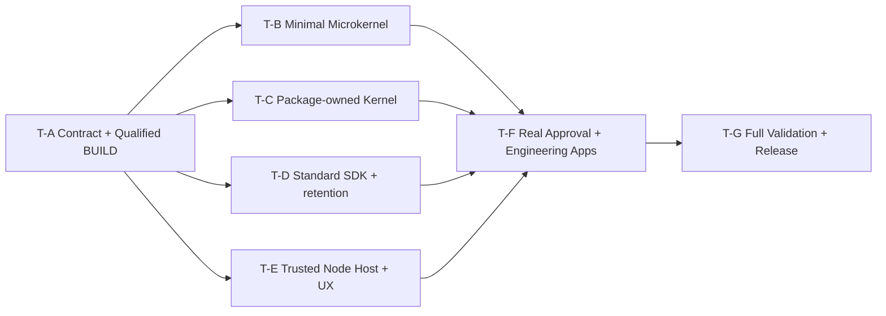

# DomainHarness v0.8 — Frozen Implementation Task DAG

**State:** Task DAG FROZEN AS PLANNING / VERSION BASELINE, no code or validation PASS asserted. Target integration branch: `v0.8`. Controller: [#999](https://github.com/kaicreator-mm/domain-harness/issues/999); Product [#953](https://github.com/kaicreator-mm/domain-harness/issues/953). Canonical implementation status after Issue materialization = **live GitHub Issue Dependencies**, not this static mirror. Do not spawn duplicate research or long-lived branch before dependencies become ready.

## Preconditions and immutable adopted facts

- Reviewed L2: `32332e15aff469c50944c2cbaa0ac0fe5990f7dd` tree `c0f8302263e7a14a92ede0664b681719bcab342b`, architecture blob `3578ef9828be59aacb71719668d75a2199be2dcc`, fresh independent PASS [#999@6108791373](https://github.com/kaicreator-mm/domain-harness/issues/999#issuecomment-6108791373).
- L2 Freeze actual remote checkpoint: `v0.8@8e27a3fd282ec3a7334666bf776ef29f156c3e1d`, [#999@6108813765](https://github.com/kaicreator-mm/domain-harness/issues/999#issuecomment-6108813765).
- Frozen Product: #953@6106639644. Historical useful outcomes IN (FR01–FR15/HF16–HF34 + 6 NEW-FUNCTION + FR08 split/NF05/NF06); old-version API/ABI/serialization compatibility OUT; no generic Host-owned domain engine.
- Research: #994@b9ea4d1 is the primary **ADAPT** source (Kernel package + KPK tests), #956@16037896 (R3 graph/descriptor safety), #978 (byte/root trust), #963 (attested bindings), #988 v0.7 oracle, #972 dual-domain A/B research. Do not merge whole research branches. #996 and #998 CI staging already adopted; do not reimplement.
- Architecture and implementation distinction: #994 Kernel `completeEffect` CAS is known broken by revision discard; repair is mandatory in **T-C/T-E**, verified in **T-G**, not accepted by research PASS. #994 public Host-port injection is forbidden: `load(package)` one public argument, protected installer-only Host binding.
- Pinned ADS `ai-development-standard@1edaee9291e25b6dd99303493bed75132cb54881`; one concern/PR, risk-based independent review, Tests → Contract → Implementation → Failure Handling → Reference; JIT branch after predecessor merge. PR CI PASS does not equal Release PASS.

## Dependency graph and admission



**Parallelism:** T-A is the sole code prerequisite. Once its contracts and source branch are merged, T-B/T-C/T-D/T-E may execute in **four disjoint worktrees and write sets**. T-E builds Host secure primitive and UX adapter to T-A's contract; integration against B/C occurs in T-F, so no unreviewed parallel private-ABI drift. T-F can begin fixture/test authoring once interface snapshots are frozen but cannot claim integration PASS before all B/C/D/E merge. T-G is an independent Build Host / validation actor after T-F; test-plan/Hidden-pack planning is allowed earlier without claiming execution.

## Seven concrete concerns

| ID | Scope and output | Blocked by | Review | Priority / executor |
| --- | --- | --- | --- | --- |
| T-A | Canonical selected Package/Component/Kind/Operation ABI, strictly validated Graph, secure qualified BUILD/producer output, exact binding, protected Host bootstrap contract and complete functional test manifest | L2 Freeze | **REQUIRED** independent high-risk ABI/security | P0 / ChatGPT Web L3 + local builder |
| T-B | Minimal SDK Microkernel `load(package)` physical selected import, lifecycle/wiring, scoped non-privileged public facade | T-A | **REQUIRED** trust/API boundary | P0 / local builder |
| T-C | Physical selected Kernel Domain Package owns State/Guard/Admission/Effect/UNKNOWN/Journal/Replay and per-occurrence business effect; repair CAS revision-loss | T-A | **REQUIRED** durable/effect authority | P0 / local builder |
| T-D | Standard SDK Package: 5 seed Kinds (Schema/Rule/Decision/Workflow/Operation), safe interpreter/Projection and FR08 truthful ModelPort, assigned retained functions | T-A | **REQUIRED** model authority and historical semantics | P1 / local builder |
| T-E | Qualified Node Host/physical storage, protected issuer/identity, actual atomic CAS and scoped UX intent/query/subscribe transport, no raw Journal | T-A | **REQUIRED** Host security/durability | P0 / local builder |
| T-F | **Two real** Domain Harness Apps: Approval and Engineering self-dogfood sharing identical K/S bytes, distinct B, typed UX; original v0.7 functional oracle comparison and clean consumer | T-B,T-C,T-D,T-E | **REQUIRED** Product/CJ/security integration | P0 / local builder |
| T-G | Real Node22/24, negative/adversarial, SQLite/file crash/concurrent Host, 34+6 function retention, v0.7 functional equivalence, full regression, Hidden/Critical Journeys/Packaging, independent review, Release Qualification/Tag | T-F | **REQUIRED** independent validator + release owner | P0 / local validator |

### T-A — Tests → Contract → Implementation → Failure Handling → Reference

- **Tests:** `V08-ABI-A01-P/N1..N6` (issuer delegation, forged producer, malicious transitive code, TOCTOU, dangerous JS records, ambiguous provider, failed activation). Machine-readable manifest contains 34 FR/HF + NEW-FUNCTION01..06 + FR08 4 split slots, preserving frozen owner, historic blob, proposed +/- cases, new implementation/test paths and `NOT_RUN` state.
- **Contract:** `load(package)` public, internal protected installer Host channel, one selected K/S/multiple B; BUILD performs static Identity/Compatibility/Binding; typed schema; closure trust and must-understand. DAC authorizes governance externally. No immediate business Runtime in BUILD.
- **Implementation:** selectively adapt #994 `src/producer/build-package.mjs`, #956 corrected R3, #978 trust and #963 bind into real TS/package modules; no duplicate legacy Host authority.
- **Failure:** reject forged issuer, unsafe getter/descriptor, graph qualified-ID collision, missing/duplicate/unapproved handler **before executable import/effect**. Independent source/security review; test exact SHA.
- **Write boundary:** contract/build/producer files and dedicated contract tests/manifest only; do not modify Kernel mechanism, Host storage or UX runtime in this PR.

### T-B — Tests → Contract → Implementation → Failure Handling → Reference

- **Tests:** #994 KPK01/02/03/08/10/12/13 and `V08-ABI-B01-N4/N8`; physical selected K module import, failure atomicity, package switching, no public raw Kernel or Host ports.
- **Contract:** one-arg `DomainHarness.load(package)`; return scoped `send/query/subscribe/stop`; no `compiledApp`, runtime resolver, raw `kernelRuntime`, raw Journal; Host binding provided exclusively by protected installer ABI from T-A.
- **Implementation:** selective #994 `src/microkernel/{contracts,load}.mjs` port into generic SDK, lifecycle and binding.
- **Failure:** typed unauthorized/missing module/Host injection deny; cleanup incomplete activation; no second effect runtime.
- **Write boundary:** microkernel loader/lifecycle/facade + own tests, NOT selected Kernel behavior or Host storage.

### T-C — Tests → Contract → Implementation → Failure Handling → Reference

- **Tests:** #994 KPK04/05/06/07/09/14/15; `V08-ABI-C01-N1..N10` incl. two competing same-effect terminal completions; per-occurrence dynamic input/idempotency with wrong-role/UNKNOWN/poison negative.
- **Contract:** one authoritative K admission/State/Guard/Journal/Replay/Effect pipeline, `{value,revision}` Host read, strongly conditional completion CAS with typed conflict/re-read; no unconditional fall-through, status never overwritten by concurrent terminal.
- **Implementation:** selectively port original v0.7 functions via #994 `MIGRATION_MAP.json` + actual selected `kernel-mechanism-v1.mjs`, **fix #readEnvelope revision loss** and K finalization. Stage first tests that reproduce P1-L2-CAS-01, then fix. Business authority through B bindings.
- **Failure:** crash after Effect before durable terminal => UNKNOWN with no blind non-idempotent retry; CAS conflict may return same authoritative final outcome or typed conflict; cannot claim cross-document atomicity or hostile privileged store MAC.
- **Write boundary:** K module source, K tests and owned runtime contracts only; no microkernel/Host doc-port internal implementation.

### T-D — Tests → Contract → Implementation → Failure Handling → Reference

- **Tests:** `V08-FR02/05/07/08/09/12-P/N`, `HF17/HF23-P/N`, FR08 SD1/SD2 +/-; `V08-ABI-D01-P/N1..N4`, v0.7 resolver and Projection oracle; inherited other assigned function rows.
- **Contract:** five extensible Standard Kinds, deterministic Rule/Decision/Workflow/Operation semantics, safe projections, ModelPort `measured(count)` only from trusted source otherwise `unmeasured|unsupported`.
- **Implementation:** selectively adapt #994 `sdk-standard.mjs`, version/v0.7 resolver/projection. **Reject fake `freshModelCallCount:1`** and remove direct state/effect authorization from S.
- **Failure:** wrong/unknown Kind or unsafe script, fake model accounting, unbounded candidate loops, unapproved child selection fail closed.
- **Write boundary:** Standard SDK Package and its own tests; no K admission engine or Host verifier.

### T-E — Tests → Contract → Implementation → Failure Handling → Reference

- **Tests:** `V08-ABI-B01-P/N1..N8` and `C01-N2/N7/N9/N10`, physical file+SQLite CAS (including multiprocess), authenticated read/query/subscribe with role revocation and no observer leakage.
- **Contract:** immutable approved installer; verified issuer/audience/tenant/app/instance/currentness H context; physical storage with atomic revision CAS or typed unsupported; generic resource dispatcher; typed UX send/query/subscribe and scoped event delivery with K authorization.
- **Implementation:** adapt #994 memory/file Host only for generic primitives + true Node physical Host, authenticated H bootstrap, UX-client intent transport, no direct `journal` read bypass; keep scoped application UX outside domain-harness authority.
- **Failure:** fake principal/ports denied pre-import/effect, cross-tenant/role leakage denied, CAS revision mismatch/missing expectation MUST NOT degrade to unconditional put, no false ACK.
- **Write boundary:** Node Host/adapters/UX boundary and tests, never duplicate K policy/Effect or merge T-C code.

### T-F — Tests → Contract → Implementation → Failure Handling → Reference

- **Tests:** two independently meaningful End-to-End Domain Harness Apps (**Approval** D2; **Engineering Harness self-dogfood** D3), same exact sealed K/S modules, distinct B and UX; real read/write/effect/WAIT-resume/Journal/replay/UNKNOWN, unauthorized mutation, clean packed consumer.
- **Contract:** first handcrafted or system-produced approved Genesis obeys BUILD format; domain-forge normal later producer but no pretend fully integrated cross-repo creator/forge/simulator. Domain UX is separate transport, no authority.
- **Implementation:** concrete business packages for Approval and Engineering with real intents/state/guards/effects; observe running harness behavior, original accepted v0.7 functional oracle differential; never replace dogfood with toy Inventory fixture.
- **Failure:** fresh K/S package substitution rejection, stale binding, false positive ACK, replay/duplicate effect, compromised caller typed denial; original useful behavior must survive under new ABI.
- **Write boundary:** application fixtures/examples/e2e/consumer tests and **only minimal bounded integration fixes via own issue/PR** (if actual B/C/D/E regression, return owner task).

### T-G — Tests → Contract → Implementation → Failure Handling → Reference

- **Tests:** exact frozen candidate real Node22/24 Windows/Ubuntu where supported, full suite, targeted faults, true physical concurrent competing journal completion, all frozen FR/HF + NF05/NF06 + NEW-FUNCTION + FR08 +/- manifest, critical journeys, clean package install, independent oracle/Hidden.
- **Contract:** Version Closure → Critical Journeys/Full Regression → Hidden Validation → Packaging → Release Qualification; record exact commit/tree, Host, commands, failures, skips and waiver-only genuinely environmental CI issues, not safety/product P0/P1.
- **Implementation:** validation/evidence only, not a duplicate SDK rewrite; bounded bug fixes routed to owning concern and revalidated at changed SHA.
- **Failure:** any CAS/source trust/read bypass/UNKNOWN false ACK, missing delivered function or missing real D3 => Release HOLD. `PR_PASS != RELEASE_PASS`.
- **Write boundary:** tests/evidence/closure docs, external Hidden maintained in its permitted repository; no Hidden tests exposed in public implementation PR. Independent validator must not review/validate own implementation.

## Issue materialization / actor policy

Create **exactly one initial Issue per T-A..T-G** after this DAG checkpoint. Set `blocked by` dependencies as graph above, per-Issue Review Policy and initial `QUEUED` state (T-A `READY`). GitHub native Issue Dependencies are canonical live links where tool access permits; plain Markdown `blocked by` is only a mirror and MUST NOT be falsely reported as canonical dependency registration. If connector cannot mutate dependency edges, one bounded local/API handoff may add these exact edges without creating issues/branches. No build Claim solely from issue creation; Builder must JIT re-read live head and predecessor merges and post one Claim before code changes.

```ini
EVENT=V08_TASK_DAG_FROZEN_PLANNING_CHECKPOINT
PRODUCT_FREEZE=#953@6106639644
L2_FREEZE=#999@6108813765
TARGET_BRANCH=v0.8
TASKS=T-A;T-B;T-C;T-D;T-E;T-F;T-G
DEPENDENCIES=A->B,A->C,A->D,A->E,B->F,C->F,D->F,E->F,F->G
FIRST_READY=T-A
L3_EXECUTION=TESTS_CONTRACT_IMPLEMENTATION_FAILURE_HANDLING_REFERENCE
RESEARCH_PR_AUTO_MERGE=NO
CAS_PROOF=REQUIRES_IMPLEMENTATION_AND_REAL_TESTS
RELEASE=NO
```
