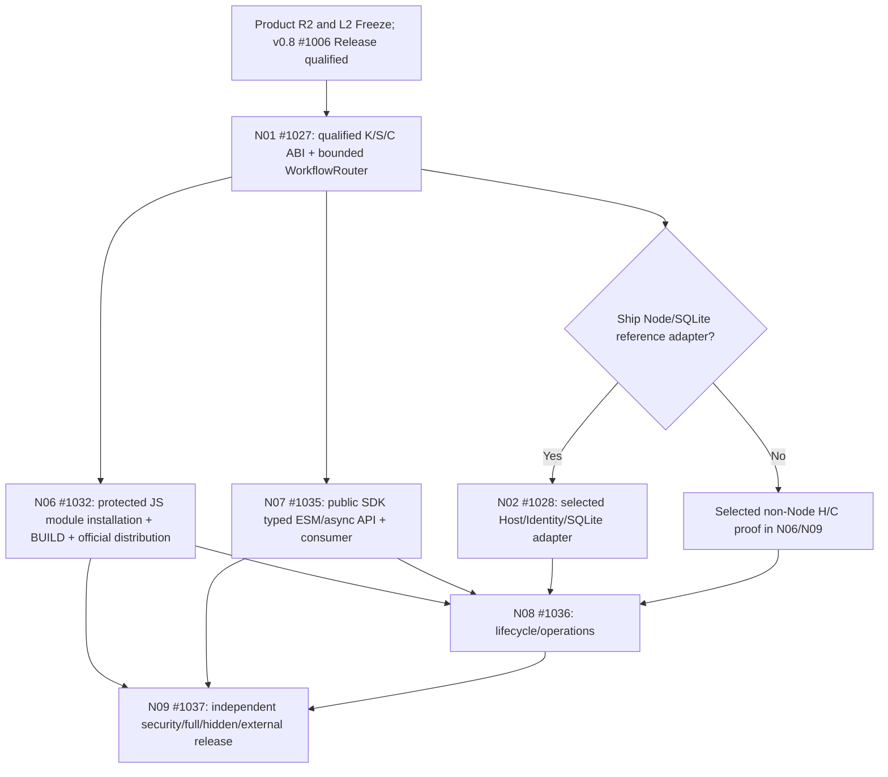

# DomainHarness v0.9 — Task DAG R1 Pre-admission Draft (JS/TS Core)

```ini
STATUS=PLANNING_DRAFT_NOT_FORMAL_DAG
OWNER=#1026
PRODUCT_SCOPE=R2_F01_F10_FROZEN_PR1048
ARCH_CANDIDATE=PR1049@31143916626300a83d1e1860e48b79b725584558
L2_FREEZE=NOT_YET
V08_RELEASE_BASELINE=NOT_QUALIFIED_#1006_OPEN
TASK_ISSUES=EXISTING_#1027_#1028_#1032_#1035_#1036_#1037
SOURCE_IMPLEMENTATION=NOT_AUTHORIZED
PR_LEVEL_CI_WAIT=SKIPPED_BY_USER_DIRECTION_ONLY
SECURITY_REVIEW_AND_RELEASE_VALIDATION=REQUIRED
```

## 1. Scope and acceptance

This is an **execution-planning derivative** of the frozen v0.9 JS/TS Core Product R2 decisions and pending PR #1049 L2. It is **NOT** formal Implementation Task DAG/Issue Dependency materialization, L3 authorization, code acceptance, CI PASS or Release Qualification. Rebase all dependencies, file write sets and exact selected source SHA when L2 actually freezes. Do **not** delete or rewrite frozen historic Product/DAG candidate blobs.

One selected **actual JS runtime + approved Host/Capability profile**, SDK/BUILD/one Kernel/one Standard/two real Approval and Engineering Apps, independent clean install, H approval/currentness before unsafe imports, K sole State/Journal/Effect/UNKNOWN, selected storage actual durability where promised. TS typecheck → portable *declared* JS ESM runtime envelope; do not promise every engine, Windows/Linux/WSL2/Node24 or universal SQLite. Node/SQLite must be qualified **only when shipped/advertised as a profile**. N03 Creator/Forge/Simulator/UX integration, N04 QuickJS, N05 remote/stream and full capability catalogue remain optional.

## 2. Proposed Task DAG (no native edges admitted)



The core selection of an **actual durable/identity Capability** remains obligatory for real Application Journeys; merely omitting Node/SQLite **does not remove** trusted physical H/C evidence. Selected implementation owner must be explicit before DAG materialization.

| JIT pack | Existing primary Issue | Dependency and disjoint write set | Small acceptance (Tests → Contract → Code → Failure) |
| --- | --- | --- | --- |
| A1 K/S/C contracts | #1027 | L2 frozen + real v0.8 K/S baseline; package contracts, Standard bounded semantics, no H storage | One K/S, capability binding cannot shadow roles; two real B users; missing/ambiguous route/wrong Handler typed fail; adapt v0.8 Standard before adding code |
| A2 protected build/module distribution | #1032 | A1 selected API; BUILD/seal/module trust/ESM exports, not K/Standard policy; reuse v0.8 S01 | Exact sealed bytes/Graph/versions/approved currentness; stale/revoked/tampered transitive dependency fails before unauthorized evaluation; external install |
| A3 public typed API | #1035 | A1 contract; public facade/docs/types/example, not H verifier/Journal | One-arg load(package), authenticated send/query/subscribe/stop; independent consumer; no deep import; typed unsupported JS host |
| A4 selected adapter (conditional) | #1028 | A1 and explicit Node adapter shipment decision; Capability physical implementation/tests only | If Node/SQLite selected: native atomic CAS, WAL/crash/lock/restart/backup, revocation, no H-owned domain Journal; otherwise NOT_APPLICABLE with alternate actual H/C proof in A2/A6 |
| A5 lifecycle/diagnostics | #1036 | A2 + A3, + A4 if included; bounded facade instrumentation/ops docs | Init/dispose order, primary error plus cleanup failures, restart, safe redacted diagnostics, truthful durable receipt/UNKNOWN; numeric PERF claims apply only to selected runtime profile |
| A6 exact release assurance | #1037 | A2+A3+A5, plus A4 if selected; evidence/validation-only write set | Two real Apps using same selected K/S, independent fresh external repository install, Full/Hidden/Critical Journeys, security/authorization/CAS/replay/UNKNOWN, packaged artifact provenance and release/tag only after independent PASS |

**No pre-1.0 legacy migration.** No OS test matrix at SDK Core. The conditional #1028 path must **never** be an unconditional edge for an unselected adapter. No Task should reimplement #1047 protected S01 without proving the upstream inherited delta inadequate. Domain Package *generation compiler* belongs to domain-forge; domain-harness's qualified BUILD may select/seal approved closures and publish ABI.

## 3. Work-slicing and safe parallelism (JIT only)

- **First** #1027 contract-only slice. If the exact current v0.8 Standard workflow mechanism already supplies bounded routing, prefer alias/binding over a second Router engine; N01 Core/Router implementation must have one writer for `standard-sdk` semantic files.
- After contract + pinned API, #1032's protected artifact/BUILD implementation and #1035's public consumer/API may proceed in parallel **only if distinct source paths and export ownership**; serially integrate any shared SDK barrel/manifest updates through the owning PR.
- Conditional #1028 physical adapter runs concurrently with independent public API work only when officially selected for the shipped profile; otherwise do not dispatch phantom Node/SQLite work.
- #1036 lifecycle/ops may prepare its negative proof matrix/doc skeleton early but **must not** claim run evidence before actual distributable is tested. #1037 may design Hidden probes early; actual Release Qualification only against immutable merged candidate.

**Oversized work split rule:** split within the existing owner Issue by Contract → Core → Integration → Validation when conflicting files/independently verifiable acceptance demand it; create new child Issue only when workload/write-set justifies a separate real agent claim. Each code PR = one concern + targeted P/N. Avoid multiplying research demos, 44-row duplicated runs or perpetual review rounds.

## 4. Stage gates, evidence and stop rules

| Gate | Status and required next evidence |
| --- | --- |
| Product/L1 F01–F10 | **FROZEN_SCOPE** on PR #1048. Two historical P2 routed; different GitHub credential not falsely claimed as independent |
| L2 Architecture | PR #1049 at exact head **READY_FOR_INDEPENDENT_REVIEW**, review must use separate `operator_id/session_ref` per ADS; CI wait bypass does not constitute PASS. Material P0/P1 -> one bounded correction |
| v0.8 inheritance | #1023 S01 merged PR #1047 -> branch `9ea7f6f12a51c78dec747a823db6ade620a2fa6c`; #1006 OPEN, **NOT** qualified tag/baseline. Wait for actual source/Release Qualification, not simply PR green |
| Formal Task DAG freeze | **NOT_ADMITTED** until L2 Frozen, each conditional path resolved, owner/write sets accepted and release baseline properly gated. Only then materialize GitHub Issue Dependencies |
| Implementation | **NOT_AUTHORIZED** before L2/DAG + actual v0.8 qualified dependency |
| PR-level CI | User-directed **SKIP_WAIT**, explicitly `CI_NOT_CLAIMED`. Branch protections must not be bypassed by misrepresentation; do not forge check status |
| Full/Hidden/Security/CJ/external consumer | **REQUIRED** on exact final shipped v0.9 artifact. Waivers only where ADS genuinely permits environmental CI variance; never security/product P0/P1 |
| Release | **HOLD** until one actually selected runtime+capability cohort has independent executable evidence, complete closure and pinned tag |

**Next owner action:** obtain independent exact-HEAD L2 review for #1049; freeze only after zero unresolved P0/P1 and disposition of material UNKNOWNs. Adopt this file as *formal* Task DAG only by a separate explicit controller freeze/approval checkpoint after re-reading latest L2 and v0.8 release pins. At that point check live Issue claim/PR occupancy; do not duplicate work claimed by another agent.
