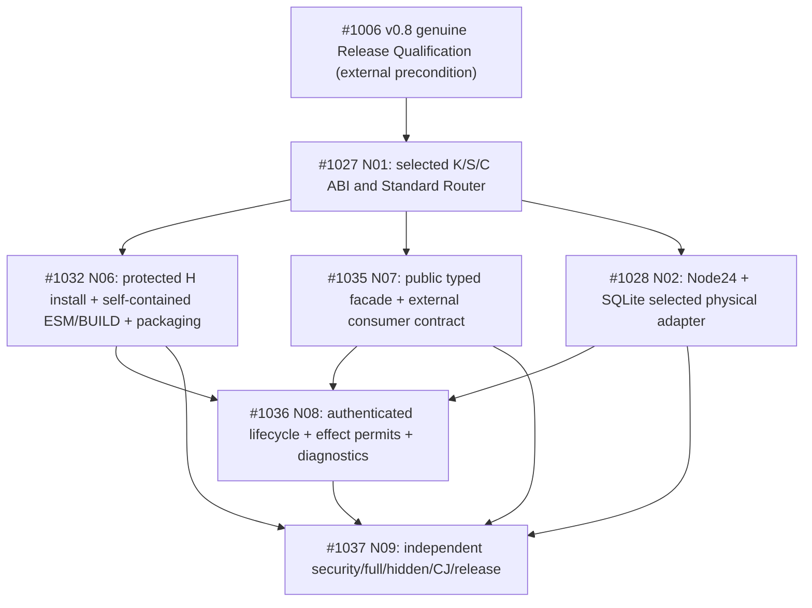

# DomainHarness v0.9 — Frozen Implementation Task DAG (JS/TS Core)

```ini
RECORD=DH09_TASK_DAG_FREEZE_V1
STATUS=FROZEN_PLANNING_TOPOLOGY_AWAITING_NATIVE_DEPENDENCY_MATERIALIZATION
PRODUCT_FREEZE=PR1048_MAIN_a51a0c57f1c66d602120e6538b4db24072a2e747
L2_FREEZE=docs/architecture/DomainHarness_v0.9_L2_FREEZE.md
L2_FREEZE_MAIN=10a01883e08f1dbdc7c8cc9883f179154ded52ba
L2_REVIEWED_HEAD=PR1049@f5e393e199654d1fddcf6730cece30f9875860fa
L2_REVIEWED_BLOB=4b127f22473c231f7fad8bbf8332260d2f4a6918
PREPARATORY_DAG=PR1050_MERGED_MAIN_30356daa5359dd44e98c4aef89986f24caff47d4
DAG_ISSUES=#1027,#1032,#1035,#1028,#1036,#1037
ISSUE_DEPENDENCIES_NATIVE=NOT_MATERIALIZED_UNVERIFIED
IMPLEMENTATION_READY_SET=EMPTY
V08_RELEASE_QUALIFIED=NO_ISSUE_1006_OPEN
V09_SOURCE_IMPLEMENTATION=NOT_AUTHORIZED
PR_CI_WAIT=SKIPPED_PER_USER
FINAL_SECURITY_FULL_HIDDEN_RELEASE=REQUIRED
```

## 1. Frozen scope / architecture control

This is the **frozen planning authority** for the six existing v0.9 implementation concern Issues, derived from reviewed/frozen L2 [PR #1049](https://github.com/kaicreator-mm/domain-harness/pull/1049) and the explicit L2 Freeze [PR #1053](https://github.com/kaicreator-mm/domain-harness/pull/1053). Its predecessor [PR #1050](https://github.com/kaicreator-mm/domain-harness/pull/1050) remains a source of traceable draft rationale only. Future changes to this frozen intended topology require a documented DAG mutation under ADS `standards/TASK_DAG_GOVERNANCE_STANDARD.md`. **This checkpoint does not itself create GitHub native Issue Dependencies or grant source implementation readiness.**

**Core P0 deliverable:** independently consumable TypeScript-authored **JS-executable** `/v9` SDK with one physical Kernel Domain Package (business State/Admission/Journal/Effect/Replay/UNKNOWN), one Standard Basic Domain Package (pure WorkflowRouter/Schema/Rule/Decision/Operation), selected capability-owned physical Handlers, two real Approval/Engineering Apps sharing bounded K/S/C, protected H Host assurance/installed-reference only load, exact selected artifact trust, external clean consumer, Full/Hidden/Security/Critical Journeys and Release Qualification.

**First selected real supported reference cohort:** Node.js **24.x ESM** + protected Host + true-CAS **SQLite** Capability/registry. Issue #1028 is **required for this first cohort**, while **not universal for every JS Core engine**. No broad Windows/Linux/WSL2/Ubuntu matrix, no full six-provider catalog, no mandatory QuickJS/polyglot/Creator/Forge/Simulator/UX production integration (N03/N04/N05 optional). Pre-1.0 historical ABI migration not required. `domain-forge` owns business Package generation; producer-neutral BUILD qualification/seal belongs in the selected SDK toolchain.

## 2. Frozen intended dependency DAG



**Canonical intended native `blocked_by` edges**, to be materialized and read back:
| Issue | Blocked by | Why |
| --- | --- | --- |
| #1027 | #1006 | real v0.8 qualified baseline before any implementation |
| #1032 | #1027 | uses frozen K/S/C ABI, no independent second authority |
| #1035 | #1027 | public facade/types must reflect one canonical Router and operation contract |
| #1028 | #1027 | selected Node24 physical H/C adapter implements actual pinned ports |
| #1036 | #1032, #1035, #1028 | lifecycle/effect token integration requires protected H install, public API and true CAS |
| #1037 | #1032, #1035, #1028, #1036 | one immutable integrated actual artifact for independent release qualification |

The `#1006 → #1027` edge is a **version-qualification dependency**, not evidence that #1006 has passed. Upstream v0.8 #1006 was **OPEN** when this DAG was frozen. Additional cross-version edges should not be guessed. GitHub **native** Issue Dependencies, not this Markdown table, are the canonical live graph once materialized. Until those edges are created and verified, **READY=NONE** and this is a frozen *planning* DAG only.

## 3. Six bounded execution packs (no new duplicate Issue swarm)

| Issue | Tests first / contract | Implementation write set (JIT verify before claim) | Failure evidence and Review Policy | Executor |
| --- | --- | --- | --- | --- |
| **#1027 N01** | Selected K/S/C ABI contracts and immutable Standard `selected|missing|ambiguous|denied` WorkflowRouter, deterministic tie, K-only State/Admission/Journal/Effect; two real business intents | selected v0.9 K/Standard Package payload + qualified binding contracts; distinct from #1032 protected H | wrong/ambiguous Handler, duplicate Kernel, forged Router bypass; **required** contract review | Web design/contract builder + local actual JS tests |
| **#1032 N06** | ESM parser/BUILD exact sealed root vectors (zero import edges, bundled dependencies), protected H whole-closure preflight, governance-only inert `install`, public opaque ref-only `load` and trustworthy activated cache | v0.9 BUILD/qualification, protected module bytes/issuer revocation/installed registry logical owner, versioned exports/packaging; not #1028 physical CAS and not #1035 façade ownership | static/dynamic/relative/bare `import`, `export from`, `import.meta`, eval, mutation, forged raw-root/currentness outage, cross-audience & cache reuse; **required** security review | Web implementation/contracts + local selected Node24 packaging/runtime validation |
| **#1035 N07** | Typed public `load(installedRef:string)`, `send/query/subscribe/stop` + single caller `PACKAGE_NOT_AUTHORIZED` family, pure Standard Router discriminated results, clean consumer using public exports only | `./v9` types/API/Quickstart/examples/external consumer reference; no direct H verifier or `getModuleNamespace` | forged/object/raw-root rejection, public lifecycle error and wrong App stop; **recommended** review, required where auth/API owner drift | Web API/docs builder + local external clean consumer |
| **#1028 N02** | First selected Node24 true-CAS SQLite H-registry/physical C ports, lock/crash/restart/concurrency/issuer-currentness and durable receipts, no business Journal in H | selected `host-v9`/capability physical adapter only; no second `host-node` Domain Package or universal OS tests | store unavailable, corrupt artifact, simultaneous CAS, delayed receipt UNKNOWN, resource teardown; **required** physical/security review | Local Build Host/Validator (Node24 actual OS/SQLite); Web source audit |
| **#1036 N08** | Per-op scoped H→K nonforgeable private tokens and one-shot effect permits, same-H CAS currentness/epoch ordering, per-sensitive-delivery stream recheck, authenticated `stop` | application lifecycle, operations, selected integration, redacted diagnostics, app-level cleanup; no ownership of K Journal/H trust registry | cross-App/tenant, stale/revoked scope, concurrent revoke vs effect, in-flight ACK/UNKNOWN, dispose cleanup; **required** integration review | Web integration builder + local real two-App execution |
| **#1037 N09** | Independent release assurance plan/checklists/hidden pack: exact SHA + selected Node24 profile + two real Apps + fully clean consumer, physical CAS/durability/UNKNOWN/full/hidden/CJ/security | validation/evidence only; no source-writing into the candidate being independently adjudicated | untrusted import, unauthorized effect, forgery, replay, fault injection; independent review + final authority qualified; **required** | separate Web independent Reviewer + local real Build Host Validation |

**PR slices where truly necessary:** Contracts → Core → Integration → Validation, one concern per PR; shared exports/module manifest have **one** owning writer. Do not rerun a full candidate suite per acceptance row; targeted P/N in each PR, once-per-frozen-candidate Full/Hidden/packaged end-to-end closeout. No extra research demo unless implementation reveals an actual material architectural contradiction, at which point reopen only affected L2 fact.

## 4. Admission, materialization and release rules

1. **Freeze this planning DAG document only.** No Issue status should be set READY until GitHub native edges above exist (and readback agrees) plus #1006 real qualified v0.8 baseline is proven. This document itself does not confer authority to modify v0.8 or v0.9 source.
2. **Native Issue Dependencies:** tool actor must add the six sets of exact `blocked_by` edges above (12 edges counting all row entries), JIT inspect for existing edges, create only missing edges, read back and compare exact topology; route conflicts to Controller, do **not** create duplicate Issues. Count: #1027(1)+#1032(1)+#1035(1)+#1028(1)+#1036(3)+#1037(4) = **11 total edges**. If native writes unavailable, leave `MATERIALIZATION_PENDING` without pretending the Markdown edge table is canonical.
3. **Task Pack currentness:** each existing Task Issue needs a short reviewed Task Pack status/checkpoint referencing this frozen DAG, exact L2 source and baseline qualification. Do not overwrite issue historic bodies or substitute stale pre-R2 OS-only requirements. Review Policy and write-set owner are in §3, to be confirmed just-in-time.
4. **Only then** dispatch the actual ready cohort (normally first #1027, after v0.8 #1006 PASS and native graph verified). Review P0/P1 findings block per policy, but user-directed skipping routine PR CI wait is acceptable **only** within repo protections and does not counterfeit green CI.
5. **Security/full/hidden/actual selected-node release:** never waive missing physical true-CAS/UNKNOWN, immutable module trust, independent external consumer and full frozen-candidate evidence. `PR_PASS != RELEASE_PASS`. Actual v0.9 tag/release qualification comes only after #1037 independent terminal on exact packaged bits.

## 5. Explicit completion/unknown

```ini
PRODUCT=FROZEN
L2=FROZEN_EXACT_SUBJECT
DAG=FROZEN_PLANNING_ONLY
ISSUE_NATIVE_EDGES=NOT_CREATED_OR_READ_BACK
READY_ISSUES=NONE
V08_BASELINE_RELEASE_PASS=NO
V09_IMPLEMENTATION=NOT_STARTED
V09_FULL_HIDDEN_SECURITY_RELEASE=NOT_RUN
```

**Task DAG Freeze decision:** the intended six-Issue topology and acceptance ownership above become immutable planning authority when this exact file merges to `main`. Live execution-state authority remains **HOLD** pending GitHub native Issue Dependencies and the v0.8 #1006 qualified release. No Product/L2 expansion or new Tasks are authorized by this Freeze.
