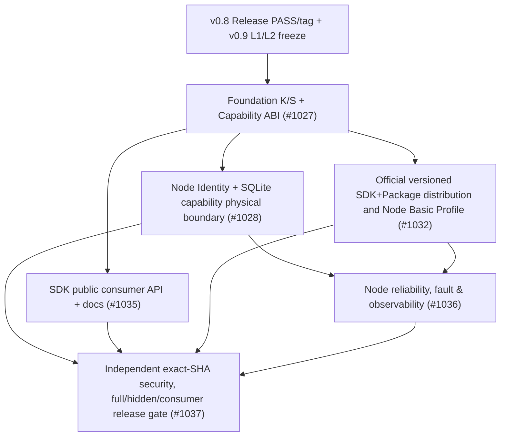

# DomainHarness v0.9 — Bounded L1→L2→Task DAG Preparation Plan

```ini
STATUS=PLANNING_ONLY_PROPOSED_NON_EXECUTABLE
PARENT=#1026
SOURCE_PR=#1033
PRODUCT_L1_FREEZE=NO
L2_FROZEN=NO
FORMAL_DAG=NOT_ADMITTED
CODE_CLAIMS=NONE
PR_MERGE_POLICY=ONE_CONCERN_ONE_PR_AND_EXACT_SHA_REVIEW
```

**Latest user priority (2026-10-14):** no Windows/Linux/WSL2/Node24/native SQLite *SDK Core P0 matrix*. N01 K/S semantics, N06 JS/TS packaged SDK/BUILD, N07 public type/ESM contract and N09 real JS runtime/selected capability security are Core P0. N02 Node Identity/Storage is an **optional/reference adapter concern**, independently qualified only when included in declared v0.9 distribution; N08 Node/SQLite PERF/ops targets attach to that reference adapter, not global Core. The six historical issue numbers remain for traceability; **this is a proposed DAG, not a formally admitted/split one**. Exact dependency edges and Node profile inclusion require Product/L1 re-review.

## 1. Version strategy and sequencing

The v0.9 **Product target** is fixed directionally: production-ready **JS/TS SDK Core** with a selected real JS execution target by version closure. Product Freeze and **provisional, non-executable L2** may advance while v0.8 remains in development; **do not start v0.9 source implementation or claim a qualified v0.8 baseline** until actual v0.8 Release Qualification/Tag passes. Avoid another exploratory pre-L2 research/Demo campaign; reuse actual v0.8 built K/S/Host, Approval/Engineering and P/N tests.

**Pre-freeze handoff (WEB owner):** product/architecture review of proposed Foundation Package Set, Node Basic Profile, realistic published support targets, benchmark acceptance budget, public SDK shipping model and security owner boundaries; one concise independent exact-head Product review. A review issue can be created **only if an existing #1026 / PR #1033 review route cannot capture the terminal**; do not mint one new Issue per question.

**After independent Product/L1 PASS:** record a formal Product freeze checkpoint (bounded scope, exact SHA/tree, accepted optional deferrals), then L2 contract from current source/**provisionally** mapped v0.8: Package manifest/ABI and semantic split, ownership, Host assurance, prelinked selected artifact, independent activation, no K-shadow, Standard Workflow semantics, Node native driver and external consumer. An independent architecture review is required for authority-changing concerns. **L2 is not approved by this file.**

**After L2 PASS:** formalize a *small* Implementation Task DAG from the following **existing** candidate owner Issues, resolve readiness/env, split oversized tasks only if file write sets or executable acceptance truly require it. No new six parallel research campaigns, no duplicated v0.8 functional retention and no cross-repo generator P0 scope.

## 2. Six-concern candidate DAG (issues exist; edges are NOT registered)



### Exact ownership of Standard WorkflowRouter — P2-01 closure

**Design/contract owner: N01 #1027**, because WorkflowRouter is a **Standard Domain Package semantic feature**, not a public Microkernel runtime or a physical H adapter. Source target: selected `standard-sdk-v1.mjs` successor **only when** a fresh L2 source map proves the current five-Kind `interpret('workflow')` plus existing Kernel routing cannot already satisfy the needed bounded route selection. Minimum: deterministic selected-Workflow handler/step routing, typed ambiguous/missing/forbidden responses and *two existing Approval/Engineering users*. Explicitly **not** a second occurrence State/WAIT/Journal implementation. A zero-new-code thin public binding to proven existing Standard+Kernel logic is preferred when sufficient.

**Consumer-facing API/docs owner: N07 #1035**, which may export/document the WorkflowRouter operation *after* #1027 supplies a frozen semantic contract; N07 must not independently implement a second Router. **Physical Node implementation and H/SQLite owner: N02 #1028**, which must not edit the Standard Router file or Kernel mechanics. N06 #1032 only packages the approved artifacts/profile and must not amend their semantics.

**JIT size/write-set rule:** In the later **formal Task DAG** (not this proposal), if #1027's Capability/Package metadata concern and Standard Router need overlapping large source work, split its implementation into bounded **N01-Contract** and **N01-Router** child task packs with disjoint source write sets and a single controlling #1027 owner; do **not** spawn two concurrent builders on `standard-sdk-v1.mjs`. Pin the actual current v0.8 release SHA/physical K/S payload first. This explicitly assigns the contested Standard semantic owner without creating an issue or implementation claim now.

Potential parallelism after **bounded ABI Contract**: #1028 Node physical capability work and #1035 public consumer docs/API work can proceed **only in separate write sets**; #1032 packaging must consume pinned ABI and avoid changing their in-flight public exports. #1036 after physical lifecycle/packaging. #1037 runs **only after merged exact candidate**; test design/hidden pack preparation may be concurrent without fake validation. No fully locked dependencies or claims until Task DAG freeze.

| Stage / reuse | Responsible existing Issue | Minimal evidence | Code ownership boundary |
| --- | --- | --- | --- |
| P0 Read/reuse/accept v0.8 | #1026 (program) | actual v0.8 released code/Test SHA, known issues, define minimum JS module/ESM+async+Host capability contract and selected runtime qualification plan without OS matrix | **No code**, no new demo |
| P1 Foundation Contract + Standard workflow routing semantics | [N01 #1027](https://github.com/kaicreator-mm/domain-harness/issues/1027) | one K, one S with WorkflowRouter, selected capability contracts, owner-only manifest ABI, 2 distinct real consumers | Package contracts/metadata, no K algorithm rewrite |
| P2 Selected Node adapter (conditional) | [N02 #1028](https://github.com/kaicreator-mm/domain-harness/issues/1028) | identity H-verified, storage SQLite actual CAS and resources across 2 apps; no unqualified Node/OS claims | capability-owned Node adapter and tests; H assurance retained |
| P3 Official distribution | [N06 #1032](https://github.com/kaicreator-mm/domain-harness/issues/1032) | reproducible versioned SDK/BUILD/K/S/Identity/Storage, locked Profile, package hashes, external clean install | pack scripts/manifests, not runtime policy |
| P4 Public consumer UX | [N07 #1035](https://github.com/kaicreator-mm/domain-harness/issues/1035) | typed documented API, no private imports, correct authenticated client + standard Workflow semantics | public SDK facade/docs/examples, not Host trust bypass |
| P5 Operations | [N08 #1036](https://github.com/kaicreator-mm/domain-harness/issues/1036) | measured exact Node24 supported-profile failure/start/recovery/resource/backup and redacted diagnostics | ops instrumentation/runbooks, no duplicate Journal |
| P6 Release / independent adversarial | [N09 #1037](https://github.com/kaicreator-mm/domain-harness/issues/1037) | exact candidate full/hidden/CJ/security/native/consumer review, tags/baseline | evidence/validation; source regressions routed to owning concern |

**Mandatory SDK Core Product targets**: N01-min/N06/N07/N08/N09. N02-min Node Identity/SQLite is **conditional when shipped as a production-qualified reference adapter**, not universal Core P0. Optional: N01 broad capability market, N02 Browser/Embedded/full Host refactor, [N03 #1029](https://github.com/kaicreator-mm/domain-harness/issues/1029) external app generation ecosystem, [N04 #1030](https://github.com/kaicreator-mm/domain-harness/issues/1030) QuickJS/multilanguage, [N05 #1031](https://github.com/kaicreator-mm/domain-harness/issues/1031) streaming/remote. These cannot be silently promoted into version critical path.

## 3. Gates, defects, ownership, and risk-based planning

- **L1** freezes Product Package names as *IDs* only if reviewed; names in Foundation doc currently candidate. Reviews test feasibility, support matrix and benchmark target against real v0.8 evidence once available, do not infer actual Node support from planning.
- **L2** resolves exact manifest format, "separate installable Package" vs "separate npm workspace", immutable-byte binding and issuer/Caller assurance owner, dependency/version and fatal/UNKNOWN error shapes; no general Host Domain Package, no duplicated Microkernel State/Effect/Journal.
- **Environment**: Product Freeze specifies minimal JavaScript module/async ABI and selected Host Capability contract, with adapter-specific qualified release tests, not a compulsory Ubuntu distribution, physical server or pre-freeze performance run. For release, test exact claimed Windows/Linux/WSL2/VM/container profile with native SQLite ABI, durable filesystem, crash/recovery, clean installation and Full/Hidden/CJ; no profile gets an inferred PASS. Existing WSL2 preflight can be reused; no endless extra-host search. An unsupported platform gets explicit NOT_QUALIFIED in the published support matrix, not a dishonest general cross-platform promise.
- **L3 concern granularity**: each accepted PR should own one source write set + tests, 1–3 falsifiable acceptance objectives, no standalone multiple-round testing subissue. If one concern exceeds manageable write set, split **Contract → Core → Integration → Test**, keeping one actor per conflicting Kernel/Host API write region.
- **Reuse**: v0.8's `packages/domain-harness`, `domain-harness-compiler` K/S payloads and Node/SQLite/UX are default. Do not regenerate or build a third fake Demo when two true apps exist.
- **Failure classification**: false authorized release ACK, forged authority, state/Journal split-brain, unapproved module import, unauthorized agent effect, stale subject reactivation, and missing supported-profile native evidence are **Release HOLD** (never low-ROI waive). Cosmetic old-path reshaping, full multi-platform driver family, old-v0.x compatibility, secondary adapter prototypes may be deferred after Product review.
- **Evidence**: PR CI PASS is not version PASS. One independently verified release HEAD, full/hidden/CJ, distribution/clean consumer, physical fault tests, security review and exact tag; waivers only genuinely allowed environmental cases under ADS.

## 4. Minimum review agenda and admission outputs

1. Review Core Product objective and required Foundation Package Set: JS/TS SDK, K, S (Workflow inside), **selected** Capability Contract and BUILD (Node Identity/SQLite/Profile conditional); externally generated Business Package is not mandatory for v0.9 SDK readiness.
2. Validate Node Production Qualification doc: Core JS/TS executable contract, actual K/S/B and secure selected Host bindings are **PRODUCT ACCEPTANCE CRITERIA**; Node/SQLite reference PERF-01–07 are optional selected-adapter tests, not already measured pass results; do not require a special Ubuntu/native host for Product Freeze. Confirm actual qualification environments before **Release**, adjust criteria only by reviewed Product change control.
3. Confirm `v0.8 RELEASE_HOLD` if inherited requirements not passed. The v0.9 plan may review early but cannot use unqualified v0.8 source as an accepted released foundation.
4. Independent reviewer posts one terminal with exact PR HEAD, frozen Product owner/security invariants, any necessary P1 corrections, explicitly `PASS_L1_REVIEW` or `NEEDS_REVISION` and whether a follow-up Product Freeze checkpoint is authorized. **The document author cannot self-certify independent review**.
5. After review and necessary repair, one Product Controller records L1 freeze; L2 uses adopted exact blob SHA; only then create actual formal DAG/dependency state and implementation authorization.
6. On final Release: assert `V09_PRODUCTION_READY=PASS` **only** with actual evidence from N09 including supported profile and independently installed real App/SDK.

`VERSION_PROGRESS=PLANNING_TARGETS_PREPARED; IMPLEMENTATION=NOT_STARTED; TESTS=NOT_RUN; L1_FREEZE=NO; L2_FREEZE=NO; RELEASE=HOLD.`
