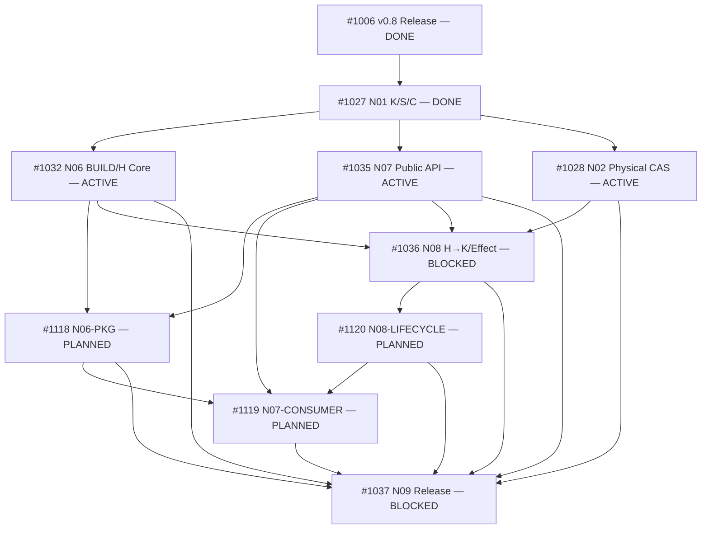

# DomainHarness v0.9 — ADS 4.12 targeted Task split successor R1

**STATUS: PROPOSED, NOT FROZEN / NOT NATIVE-MATERIALIZED / NO NEW CHILD IS READY.**

Authority: immutable ADS `4.12.0@ee8258106547abd2c2d7b9f5e87af9965e430bd2`, `standards/TASK_DECOMPOSITION_STANDARD.md` §§1–14, `TASK_DAG_GOVERNANCE_STANDARD.md` §§3–9 (SPLIT and `dag-mutation-record-v1`), Product PR #1048, L2 PR #1053, frozen predecessor Task DAG PR #1054. This is an **additive currentness-controlled successor proposal**, not an edit/rewrite of the frozen historical planning artifact. The existing GitHub-native 11-edge graph **remains live authority until a reviewed exact successor and native changes are separately installed/read back**.

Companion exact schema record: [DH09_ADS412_SPLIT_MUTATION_R0.json](./DH09_ADS412_SPLIT_MUTATION_R0.json). Mutation ID `DH09-ADS412-TARGETED-SPLIT-R1-20261017`. The independent R0 review PRR_kwDOUd_jbM8AAAABSvTlQQ on PR #1121@991dd3c **FAILED P1×3** (stale count, missing #1119 runtime predecessor, orphan send/query façade wiring). This R1 is the bounded authored correction, **NOT independently reviewed**. At discovery the integrated source was `main@44308ae2e1679df8244cf0d248df613a899b55a0`; all subsequent implementation claims must re-read current main and per-owner work sets.

## Decision: already completed work is NOT retroactively split

| Frozen parent | Truthful treatment | Evidence / how to count |
| --- | --- | --- |
| #1027 N01 | **CLOSED / unchanged.** Do not create synthetic child Issues marked DONE | Previously merged PRs #1103 (Router), #1112 (ABI types), #1111 (workspace tests), #1114 (sealed selected K/S/C + bounded two-real-B/Kernel witness). Their exact review/test evidence stays with the original PR/Issue. N01 is still **1 completed out of the original 6 core Issues**, not four new fictional Issues. |
| #1028 N02 | **OPEN / accepted Builder Claim + PR #1116**, keep present coherent physical CAS + resource port in flight; follow its current source tests/Review | Do not split accepted write set mid-execution. No retroactive re-review, no broad OS matrix. |
| #1032 N06 | **OPEN / accepted Builder Claim in progress**, keep current zero-import BUILD/AST + protected H registry/ABI work in the original Task; **defer only unclaimed distribution and shared SDK packaging** to #1118 | Existing [PR #1117](https://github.com/kaicreator-mm/domain-harness/pull/1117) at `5d8c74b51b10c45fa997125d998c97ffff48e5e6` and its accepted #1032 Builder Claim remain unmodified; no reassignment or duplicate active writer before current PR integration. If its current write set overlaps a future package path, preserve it until merged and re-pin task source. |
| #1035 N07 | **OPEN / PR #1115 active**, keep public errors + typed façade and API contract inside original Task | External clean consumer + onboarding becomes #1119 **after** N07 API and N06 packaging, without redoing #1115. |
| #1036 N08 | **OPEN / no Builder claimed at split checkpoint.** Keep H→K private scope / one-shot effect permit, **real `send/query` execution** and **single façade→operations runtime bridge writer** (post-#1035) in original Task; include revocation ordering | Split app-level subscribe / stop / cleanup / redacted diagnostics into #1120, which consumes the actual #1036 private per-delivery recheck interface; #1120 never rewrites authorization nor the public-v9 façade. |
| #1037 N09 | **OPEN / single terminal independent Release authority.** No split into fake approval Tasks | May execute risk-specific security/full/hidden/packaged tests as reviewed validation cohorts, but one exact candidate adjudication remains with #1037. |

## Proposed explicit new Task identities

| New Issue | Independent concern | Primary source responsibility | Proposed true blocking condition |
| --- | --- | --- | --- |
| [#1118](https://github.com/kaicreator-mm/domain-harness/issues/1118) N06-PKG | Reproducible v9 SDK + selected artifact distribution; root exports/manifests, clean pack/checksum | Shared `package.json`, build export map and N06-PKG-only pack tests; does **not** implement H trust/BUILD AST/SQLite/public façade | `#1032` core H/BUILD **and** `#1035` public v9 API merged and closed |
| [#1119](https://github.com/kaicreator-mm/domain-harness/issues/1119) N07-CONSUMER | New external repo install + public API example/Quickstart and negative clean-consumer proof | New external example, onboarding/docs and new consumer-only tests; does **not** author public API/Host | `#1035` public API, `#1118` packaged artifacts and `#1120` real lifecycle (which depends on #1036 operations) |
| [#1120](https://github.com/kaicreator-mm/domain-harness/issues/1120) N08-LIFECYCLE | Per-app subscribe and per-delivery scope recheck, authenticated stop/dispose, redacted diagnostics | New versioned lifecycle/stream integration modules and scoped tests; no issuance of H principal or one-shot effect permit | `#1036` private authenticated H→K/effect permit integrated and closed |

The graph has **9 original-core nodes including #1006 and three new child Issues; edges are counted separately from Tasks**. There is no artificial target Task count. File count and estimate are not decomposition criteria; one coherent invariant defines each leaf. Contract and security atomicity is preserved: parser+byte gate stay with present N06 Core Builder, CAS+physical port stay with active N02 Builder, private H→K effect/revocation ordering stays with N08 Core. Owners of shared source paths are clarified before further Claims. Completion of the three new Issues adds to future *leaf* metrics but does **not** retroactively change the historical "1 / 6 original core parent concerns closed" denominator.

## Graph: 11 existing edges are preserved; 9 new edges proposed

Added GitHub-native `blocked_by` operations (use **actual GitHub Issue ID**, not displayed issue number when invoking REST):

1. `#1118 ← #1032`
2. `#1118 ← #1035` (v9 SDK public export must exist before final packaging)
3. `#1119 ← #1035`
4. `#1119 ← #1118`
5. `#1120 ← #1036`
6. `#1037 ← #1118`
7. `#1037 ← #1119`
8. `#1037 ← #1120`
9. `#1119 ← #1120` (the real two-B send/query/lifecycle external consumer must await protected operation and lifecycle implementation)

No existing native edges are to be deleted. This avoids a parent-child deadlock: each retained original Issue now has its own *coherent narrowed* terminal contract, closes on that real completed concern, then its downstream split Issue may become ready. This parent acceptance narrowing is a **material Task Pack successor**, not silently effective from this prose. Required exact Issue pack amendments and live dependency verification precede any new child Claim.

## R1 normative concern ownership — closes R0 P1-3 without reintroducing concurrent writers

**#1035 N07 public façade contract owner:** owns the stable `/v9` TypeScript signatures, public error families and safe `load(installedRef:string)`, `send/query/subscribe/stop` **contract shapes only**, plus a protected-internal **interface declaration** for downstream selected Host operations. It must not issue caller-controlled Host tokens or pretend an unimplemented operation is executable. Its accepted public code and in-flight PR #1115 are historical inputs; #1035 need not await #1032 merely to author/verify contract types, while runtime `load` execution cannot claim PASS without actual protected #1032 Host.

**#1036 N08 one implementation/wiring owner:** retains actual `send/query` operation dispatch through the authorized selected H→K route, per-operation scoped principal and one-shot effect-permit/revocation ordering. It uniquely owns the post-#1035 **façade→operations runtime bridge** (prospective new `src/public-v9/operation-bridge.ts` or precisely equivalent single owned integration file, plus `src/operations-v9/core-gateway.ts`), including stable private lifecycle registration/delivery-currentness seam; no concurrent #1035 Builder writes to this file after its source closure. The bridge must consume H-minted issuer-bound private handles, never public caller-supplied callbacks/ports or `AuthorizedPrincipal` records. The existing `/v9` export subpath **must remain anchored to a stable public barrel**; #1036 may add the internal bridge module without changing `package.json` (exclusive #1118 writer). If a different export-map change becomes strictly required, it must be requested as #1118-owned bounded integration after #1036, not performed by a second writer.

**#1120 N08-LIFECYCLE consumes**, but never reimplements, #1036's protected `recheckDeliveryAuthorization` (the actual identifier/signature is frozen in the #1036 Execution Pack), and implements stream delivery/stop/dispose/diagnostic adapters through that already-selected private port. It **does not write `public-v9/**`**; if a concrete lifecycle-to-public bridge hook was omitted by #1036, escalate to its owning Task Pack for a serialized integration repair before starting #1120 (never invent a public Host injection escape or mark its tests PASS).

**#1118 N06-PKG export map:** blocked on #1032 and #1035, installs a canonical versioned public `./v9` entry with real SDK compile artifacts and private Host/BUILD closure without semantic Host rewrites. Its targeted packaging baseline may prove typed import/installed-only `load` ahead of N08; it must not claim complete executable `send/query/subscribe/stop` until #1036/#1120 integrate. The fully executable distributed consumer is tested **only after #1120** by #1119 and independently by #1037.

**#1119 N07-CONSUMER:** waits for #1035, #1118 **and #1120**, preserving genuine two-B `send/query` and lifecycle walkthroughs; mere typed imports or refusal checks do not satisfy its frozen positive test. #1037 remains the sole final independent Release qualification and verifies exact last integrated packed bits.

## Acceptance protocol and blockers

1. **Source/writer currentness:** JIT read `main` and current N06/N02/N07 Claim and PR heads. Accept the three successor concerns without moving any in-flight source byte or changing their accepted Builder operator. A conflicting write-set or materially changed source invokes a bounded new mutation, not automatic override.
2. **Review + Controller acceptance:** Review this **exact successor PR HEAD and JSON schema** for Product/L2 invariant ownership, no extra duplicate Runtime/Host and no cycles; record accepted `SPLIT` decision. Do not treat a draft PR as already qualified.
3. **Native materialization:** Use an authenticated GitHub-capable executor to add the **nine** GitHub native Issue Dependencies, verify all **20** exact edges (11 old + 9 added), ensure no extras and no partial write-on-failure. Until this point all three new Issues must stay **NOT_DISPATCHABLE**, independent of label or comment.
4. **Task Pack successor:** Update parent scopes for #1032, #1035 and #1036 at a safe checkpoint and record affected source owners; the child Task Pack facts already live in #1118/#1119/#1120 bodies. Never erase their or the parents' historic Claim/Review evidence. The parent scopes become effective **only after mutation acceptance**. #1027 stays CLOSED, #1028 Builder and PR #1116 stay untouched, #1037 final assurance remains one exact final candidate.
5. **Execution + cost:** One concern per independently reviewable PR; targeted affected-source P/N and risk-derived reviews; no unnecessary full/hidden loop until final #1037. Ready sets follow native edges; the current new Issue state is intentionally OPEN without admitted Claims, **not ready**.

**Known tool limitation during authoring:** GitHub connector supports readback of `/issues/{n}/dependencies/blocked_by` and Issue creation, but exposes **no mutation action** for native dependencies. This record explicitly does **not** claim that proposed edges are already installed. The mandatory native step needs an authenticated Build Host `gh api`/REST-capable execution, only **after** review+acceptance. This is a technical dependency, not a new approval identity or account verification gate.
